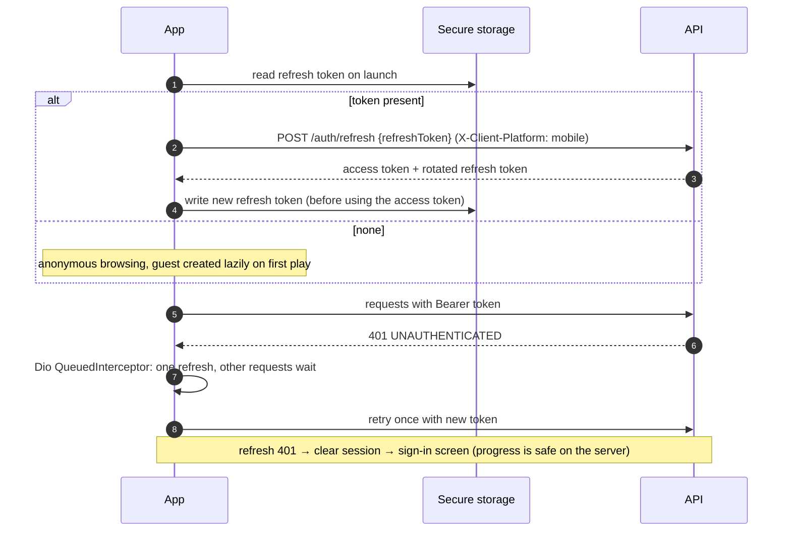
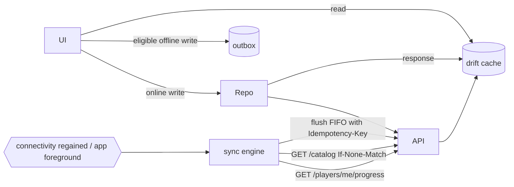

# Mobile Architecture — Flutter (Android & iOS)

|              |                                                                                  |
| ------------ | -------------------------------------------------------------------------------- |
| **Status**   | Proposed — for approval                                                          |
| **Location** | `apps/mobile` in the monorepo (Dart package; not part of npm workspaces)         |
| **Targets**  | Android 7.0+ (API 24, covers low-end devices common in target markets) · iOS 15+ |

## 1. Technology choices

| Concern          | Choice                                                                                                                                                                                                  |
| ---------------- | ------------------------------------------------------------------------------------------------------------------------------------------------------------------------------------------------------- |
| Framework        | Flutter (stable channel, pinned via FVM) + Dart 3 (sound null safety)                                                                                                                                   |
| State management | Riverpod 3 (`Notifier`/`AsyncNotifier` per feature); hand-written providers in the setup phase, `riverpod_generator` optional once features grow                                                        |
| HTTP             | Dio with interceptors (auth, refresh single-flight, idempotency keys, logging without bodies, error mapping)                                                                                            |
| Routing          | GoRouter with `redirect` driven by the auth state provider; `StatefulShellRoute` for the main tabs; deep links                                                                                          |
| Local database   | SQLite via **drift** (typed queries, migrations, streams)                                                                                                                                               |
| Secure storage   | `flutter_secure_storage` (Android Keystore / iOS Keychain) for the refresh token                                                                                                                        |
| Models / API     | `swagger_parser` generates `freezed` + `json_serializable` models and Retrofit-style Dio clients from `docs/api/openapi.json`; repositories wrap generated clients. CI fails if generated code is stale |
| Auth providers   | `google_sign_in`, `sign_in_with_apple` (A-3)                                                                                                                                                            |
| Push             | `firebase_core`, `firebase_messaging`; `flutter_local_notifications` for foreground display                                                                                                             |
| Connectivity     | `connectivity_plus` + reachability probe (`/health`)                                                                                                                                                    |
| Localisation     | `flutter_localizations` + ARB files (`intl`), English at launch                                                                                                                                         |
| Crash/errors     | Sentry Flutter (or Firebase Crashlytics) with PII scrubbing                                                                                                                                             |
| Testing          | `flutter_test` (unit/widget), `integration_test` on emulators in CI, golden tests for key screens, `mocktail`                                                                                           |

## 2. Project structure (feature-first, layered)

```
apps/mobile/
  lib/
    main_dev.dart / main_staging.dart / main_prod.dart   flavors (API base URL, Firebase project)
    app/
      app.dart                    MaterialApp.router, theme, localisation
      router.dart                 GoRouter config + guards
      theme/                      tokens from SCREEN_INVENTORY (ThemeData + ThemeExtension: kente, pop shadow)
    core/
      api/                        Dio factory, interceptors, ApiException mapping, generated client (gen/)
      auth/                       token store (memory + secure storage), session controller, refresh lock
      db/                         drift database, tables, DAOs, migrations
      sync/                       outbox processor, catalog sync, connectivity service
      push/                       FCM registration, message routing
      widgets/                    KenteStrip, GameButton (btn-game), HpBadge, FundingBadge, TierCard, ErrorView
      utils/                      idempotency key generator, formatters, logger
    features/
      home/ story/ play/ clinical/ commander/ countries/ debrief/ account/ notifications/
        data/          repository (API + DAO), DTO mappers
        application/   Riverpod notifiers (use cases, state)
        presentation/  screens, widgets
  test/  integration_test/
```

Reviewer and admin functions are **web-only** (A-2); the app shows a "Use the web workspace" link for staff.

## 3. Navigation

| Route                                   | Screen                                                   | Notes                                                                                   |
| --------------------------------------- | -------------------------------------------------------- | --------------------------------------------------------------------------------------- |
| `/` (shell tab Home)                    | Home SC-01                                               | Bottom navigation: Home · Story · Clinical · Commander · Countries                      |
| `/story`                                | Mission list SC-02                                       |                                                                                         |
| `/missions/:key`                        | Mission intro → start/resume attempt                     | Deep link target (`https://app.<domain>/missions/:key` via App Links / Universal Links) |
| `/play/:attemptId`                      | Play SC-03/04/05 + debrief SC-06                         | Full-screen route outside the shell                                                     |
| `/clinical`, `/commander`, `/countries` | SC-07…SC-10                                              |                                                                                         |
| `/account/*`                            | Sign in/up, profile, security (sessions, export, delete) |                                                                                         |
| `/notifications`                        | Notification centre                                      | Push taps route here or to `data.route`                                                 |

GoRouter `redirect`: unauthenticated users can browse catalog routes; starting play or Commander triggers lazy guest
creation (same rule as web). `refreshListenable` is the auth controller so sign-in/out re-evaluates routes.

## 4. State management (Riverpod)

| Provider                               | Type                        | Responsibility                                                                          |
| -------------------------------------- | --------------------------- | --------------------------------------------------------------------------------------- |
| `authControllerProvider`               | `AsyncNotifier<AuthState>`  | Session lifecycle: restore from secure storage, sign in/out, guest, upgrade, merge      |
| `catalogProvider`                      | `StreamNotifier` over drift | Emits cached catalog immediately; refreshes from `/catalog` with ETag                   |
| `progressProvider`                     | `AsyncNotifier<Progress>`   | Server progress, cached snapshot for offline display; updated from answer/run responses |
| `attemptControllerProvider(attemptId)` | family `AsyncNotifier`      | Mission play state machine (current step, reveal, result)                               |
| `debriefProvider(attemptId, level)`    | family                      | Request/poll debrief, quota display                                                     |
| `hospitalControllerProvider`           | `Notifier`                  | Allocation (local) + run submission                                                     |
| `connectivityProvider`                 | `StreamProvider<bool>`      | Online/offline                                                                          |
| `notificationsProvider`                | `AsyncNotifier`             | List, unread count, mark read (via outbox)                                              |

Rules: UI widgets read providers only; repositories are injected via providers (overridable in tests); no business
rules on the client beyond presentation (locks shown from server data).

## 5. Authentication flow (mobile)



- Google: `google_sign_in` returns an ID token (server client id configured per platform) → `/auth/google`.
- Apple (iOS, and Android via web flow if desired): `sign_in_with_apple` with a SHA-256 nonce → `/auth/apple`.
- Sign-out: `POST /auth/logout`, delete refresh token, clear drift user tables (FR-2.6), unregister FCM token.
- Staff accounts: the app supports TOTP challenge on sign-in but exposes no staff features.

## 6. Error handling

| Source                  | Handling                                                                                                                                    |
| ----------------------- | ------------------------------------------------------------------------------------------------------------------------------------------- |
| Network / timeout       | `ApiException.network` → offline banner; reads fall back to cache; writes go to the outbox if eligible (§7) or show "Reconnect to continue" |
| Error envelope          | Mapped to typed `ApiException(code, message, details, requestId)`; same code → UX table as web (`WEB_ARCHITECTURE.md §6`)                   |
| 401                     | Refresh once, then sign-out flow                                                                                                            |
| 426/unsupported version | `/catalog` returns `minAppVersion`; older apps show an update prompt (force update for security fixes)                                      |
| Unexpected              | Global `FlutterError.onError` + `PlatformDispatcher.onError` → Sentry; friendly error screen with retry                                     |

## 7. Offline synchronisation

**Policy (Q3 recommendation):** browse offline; **answering a mission step or starting a shift requires connectivity**
because evaluation and rewards are server-side (answer keys never ship to the device).

| Data                                                           | Local table (drift)                                                              | Sync strategy                                                                                                                                                                                                                          |
| -------------------------------------------------------------- | -------------------------------------------------------------------------------- | -------------------------------------------------------------------------------------------------------------------------------------------------------------------------------------------------------------------------------------- |
| Catalog (tiers, countries, mission summaries, hospital config) | `catalog_*`, `etags`                                                             | On launch/foreground and every 6 h: conditional GET `/catalog` (`If-None-Match`); replace atomically                                                                                                                                   |
| Progress snapshot                                              | `progress_snapshot`                                                              | Written from every server response containing progress; displayed offline with "last synced" time                                                                                                                                      |
| Attempt in progress                                            | `attempt_cache` (player-safe DTO: answered steps + current step)                 | Allows the play screen to reopen offline in read-only state; resumes online via `GET /attempts/:id`                                                                                                                                    |
| Past results, debriefs                                         | `attempt_history`, `debriefs`                                                    | Cache-aside, read offline                                                                                                                                                                                                              |
| Notifications                                                  | `notifications`                                                                  | Cache-aside                                                                                                                                                                                                                            |
| Outbox                                                         | `outbox(id, method, path, body, idempotencyKey, createdAt, attempts, lastError)` | Only **non-reward, idempotent** mutations: profile edits, notification read receipts, debrief flags, device token registration. Flushed FIFO on reconnect/foreground with exponential backoff; dropped after 7 days with a user notice |

Conflict model: the server is the source of truth; the outbox only carries intents that are safe to apply late, so no
client-side merge logic exists. After any flush, the app refetches progress.



## 8. Push notifications

- On sign-in (and token refresh), register `PUT /devices {token, platform}` (bound to the session); unregister on sign-out.
- Android notification channels: `gameplay` (achievements, unlocks), `learning` (debrief ready), `announcements`.
- iOS: request permission after the first completed mission (not at launch); respect `notificationPrefs`.
- Payload contains only `type`, `title`, `body`, `route` — never answer content or personal data.

## 9. Security (mobile-specific)

- Refresh token only in secure storage; access token in memory.
- No API keys or secrets in the bundle; Firebase config files are public identifiers (restricted by API key restrictions
  and App Check — enable Firebase App Check for FCM endpoints if abuse appears).
- Release builds: `--obfuscate --split-debug-info`; no verbose logging; HTTP logging excludes bodies and headers.
- TLS only (Android `cleartextTrafficPermitted=false`, iOS ATS default). Certificate pinning is **not** used in v1
  (operational risk of bricking clients on certificate rotation); revisit after launch.
- Screens with reasoning text use `FLAG_SECURE`-equivalent only if required by policy (not by default).

## 10. Build, release and quality

| Item          | Plan                                                                                                                                                               |
| ------------- | ------------------------------------------------------------------------------------------------------------------------------------------------------------------ |
| Flavors       | `dev`, `staging`, `prod` (bundle ids `org.<domain>.ahq.dev` …)                                                                                                     |
| CI            | GitHub Actions: `flutter analyze`, `dart format --set-exit-if-changed`, unit/widget/golden tests, integration tests on Android emulator; iOS build on macOS runner |
| Release       | Fastlane lanes → Play Console internal testing and TestFlight from tags; staged rollouts                                                                           |
| App size      | Target < 25 MB download (Android App Bundle, split per ABI; fonts subset; images WebP)                                                                             |
| Accessibility | Semantics labels for emoji/flags and choices; dynamic type up to 200 %; contrast per Q10; ✔/✗ icons in addition to colour                                          |
| Performance   | 60 fps on a 2 GB RAM Android device; cold start < 3 s; catalog cached for instant Home                                                                             |
