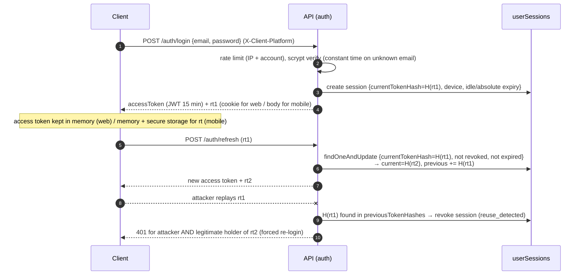
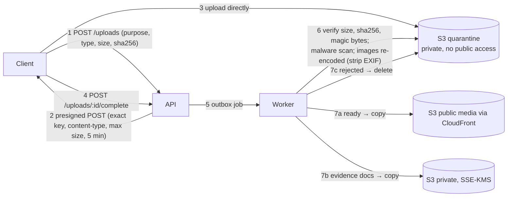

# Security Architecture — Africa Health Quest

|              |                                                                                     |
| ------------ | ----------------------------------------------------------------------------------- |
| **Status**   | Proposed — for approval                                                             |
| **Baseline** | OWASP ASVS 4.0 Level 2 · OWASP API Security Top 10 (2023) · OWASP MASVS-L1 (mobile) |
| **Scope**    | API, worker, web, Flutter apps, data stores, AI integration, CI/CD, AWS             |

## 1. Threat model (summary)

| Asset                     | Threats                                                             | Primary controls                                                                                                                                 |
| ------------------------- | ------------------------------------------------------------------- | ------------------------------------------------------------------------------------------------------------------------------------------------ |
| Clinical answer keys      | Bulk extraction from client bundles or APIs                         | Keys only in reviewer/admin endpoints; player DTOs whitelist fields; per-step reveal; shuffled choices (§10)                                     |
| Player progress / economy | Forged scores, replayed requests, race conditions                   | Server-only mutation, transactions, idempotency keys, ledger with unique source ids (§9)                                                         |
| Accounts                  | Credential stuffing, enumeration, session theft, account pre-hijack | scrypt, non-enumerating flows, rate limits + account throttling, rotating refresh tokens with reuse detection, Google/Apple linking rules (§2–3) |
| Staff privileges          | Privilege escalation, approval by an unqualified person             | Permission model, MFA + step-up, verified clinician profiles, separation of duties, audit (§4, §8)                                               |
| AI budget and integrity   | Abuse as a free LLM proxy, prompt injection, false endorsement      | Auth + quotas + budget cap, server-built prompts, correctness injected by server, output validation (§11)                                        |
| Personal data             | Leakage, over-collection, cross-border transfer                     | Minimisation, encryption, retention, rights workflows, legal review (§12)                                                                        |
| Uploaded files            | Malware, stored XSS, oversized files                                | Presigned direct upload to quarantine, type/size limits, scanning, re-encoding (§7)                                                              |
| Secrets                   | Leakage in code, logs, clients                                      | Secrets Manager, no secrets in clients, log redaction, secret scanning (§13)                                                                     |

## 2. Authentication and session flow

| Element            | Design                                                                                                                                                                                                                                                     |
| ------------------ | ---------------------------------------------------------------------------------------------------------------------------------------------------------------------------------------------------------------------------------------------------------- |
| Passwords          | scrypt N=2^15, r=8, p=1, 16-byte salt ✅; 8–128 chars with letters and digits ✅; optional breached-password check (k-anonymity range API) — decision S-1                                                                                                  |
| Login protection   | 20/15 min per IP ✅ + 10 failures/15 min per account (generic 429); constant-time compare and dummy hash for unknown emails ✅                                                                                                                             |
| Enumeration        | Register, resend, forgot-password always return the same response ✅                                                                                                                                                                                       |
| Email verification | Required before password sign-in ✅; single-use hashed tokens, 24 h ✅                                                                                                                                                                                     |
| Access token       | JWT HS256, 15 min, claims `sub, iat, exp, iss=ahq-api, aud=ahq-clients, jti, sid (session id)`; header `kid` for key rotation (two active keys in Secrets Manager); no roles in token — user and roles re-loaded per request so revocation is immediate ✅ |
| Refresh token      | 256-bit random opaque, stored as SHA-256 only, rotated on every use, reuse detection revokes the session (above). Web: cookie `ahq_rt` `HttpOnly; Secure; SameSite=Strict; Path=/api/v1/auth` ✅. Mobile: body + OS secure storage                         |
| Session policy     | Players: idle 30 d, absolute 180 d. Staff (reviewer/admin): idle 12 h, absolute 7 d, MFA required. Guests: idle 30 d (then purged)                                                                                                                         |
| Step-up            | Sensitive actions (role change, clinician verification, settings change, withdraw/retire, account export/deletion, MFA changes) require `authenticatedAt` within 15 min → `401 STEP_UP_REQUIRED` → `/auth/reauthenticate`                                  |
| MFA                | TOTP (RFC 6238, 30 s, ±1 window) with 10 hashed recovery codes; mandatory for staff (A-4). Session holds `mfaVerifiedAt`                                                                                                                                   |
| Password reset     | 1 h single-use token ✅; revokes all sessions ✅; notification email "your password was changed"                                                                                                                                                           |
| Concurrency        | Clients must single-flight refresh (web Web Locks API; mobile Dio queued interceptor) — concurrent rotation is indistinguishable from theft                                                                                                                |
| Logout             | Revokes the session, clears cookie, removes the session's device token ✅ (device token removal ▲)                                                                                                                                                         |

## 3. OAuth / federated sign-in

| Provider    | Flow                                                                                                        | Server validation                                                                                                                                           | Account linking                                                                                                                                  |
| ----------- | ----------------------------------------------------------------------------------------------------------- | ----------------------------------------------------------------------------------------------------------------------------------------------------------- | ------------------------------------------------------------------------------------------------------------------------------------------------ |
| Google ✅   | Client obtains ID token (Google Identity Services on web, `google_sign_in` on mobile) → `POST /auth/google` | `google-auth-library` verifies signature, `aud` ∈ configured client ids (web, Android, iOS), `iss`, `exp`; requires `email_verified`                        | Link by `googleSub`; else by verified email; **if the existing account's email is unverified its password is discarded** (pre-hijack defence) ✅ |
| Apple (A-3) | `sign_in_with_apple` (iOS native, web JS) → `POST /auth/apple`                                              | Verify identity token against Apple JWKS (`https://appleid.apple.com/auth/keys`), `aud` = bundle/service ids, `iss`, `exp`, nonce (SHA-256 of client nonce) | Link by `appleSub`; private-relay emails treated as verified; name captured only on first sign-in                                                |

No authorization-code flow is needed server-side (no Google/Apple API access is requested). Tokens from providers are
never stored.

## 4. Authorization (RBAC + policies)

Permissions are granted to roles (collection `roles`), roles to users (`users.roles`). Middleware
`requirePermission(...)` checks the union of permissions; **policies** in each module add ownership and state checks
(e.g. "attempt belongs to caller", "reviewer is not an author of this version").

| Permission                                                                                                                   | player | reviewer                                      | admin |
| ---------------------------------------------------------------------------------------------------------------------------- | ------ | --------------------------------------------- | ----- |
| `game:play`, `progress:read-own`, `ai:debrief`                                                                               | ✔      | ✔                                             | ✔     |
| `account:manage-own` (export, delete, MFA) — registered only                                                                 | ✔      | ✔                                             | ✔     |
| `review:read`, `references:edit`, `debrief-flags:resolve`                                                                    |        | ✔                                             | ✔     |
| `review:decide`                                                                                                              |        | ✔ (requires verified clinician profile + MFA) |       |
| `content:read`, `content:edit`, `content:publish-control`, `catalog:edit`                                                    |        |                                               | ✔     |
| `users:read`, `users:manage`, `users:manage-roles`, `clinicians:verify`                                                      |        |                                               | ✔     |
| `settings:read`, `settings:edit`, `ai:read-usage`, `analytics:read`, `audit:read`, `notifications:broadcast`, `media:upload` |        |                                               | ✔     |

**Separation of duties.** Admins author content (D5) but cannot decide reviews unless they also hold the reviewer role,
have a verified clinician profile, and did not author the version under review (`missionVersions.authoredBy`). A user
cannot change their own roles or verify their own clinician profile.

**Object-level authorization (OWASP API1).** Every query for user-owned data is scoped by `userId` in the repository
layer; ids from other users return `404`, not `403`.

**Guests** have `player` permissions but are excluded from `Registered` routes and can never hold staff roles ✅.

## 5. API rate limiting and abuse controls

| Layer           | Control                                                                                                                                                          |
| --------------- | ---------------------------------------------------------------------------------------------------------------------------------------------------------------- |
| AWS WAF         | Managed rule groups (common, known bad inputs, IP reputation), rate-based rule 2 000 req / 5 min per IP, geo/ASN blocks only if abuse appears                    |
| Application     | Fixed-window counters in MongoDB (`rateLimitCounters`) per IP/user/session/account; limits in `API_SPECIFICATION.md §15`                                         |
| Business quotas | AI daily quota and monthly budget cap; guest creation per IP; hospital runs per minute                                                                           |
| Bot friction    | Optional invisible CAPTCHA (e.g. Cloudflare Turnstile) on register/guest if abuse metrics trigger — decision S-2 (off by default to respect low-bandwidth users) |
| Monitoring      | Alarms on 401/429 spikes, failed-login rates, AI cost/hour                                                                                                       |

## 6. Input validation and output encoding

- **Every** request body, query and path parameter is parsed with a zod schema from `packages/api-contracts` before use ✅;
  unknown fields are stripped; strings have max lengths; numbers ranges; enums closed.
- Parsed values are scalars or typed objects, so client-supplied MongoDB operators cannot reach queries ✅ (tested).
  Regex search input is escaped ✅.
- JSON body limit 100 KB ✅; upload bodies never pass through the API.
- Output: React escapes by default; no `dangerouslySetInnerHTML`; AI text rendered as plain text/structured fields
  (no Markdown HTML). Flutter renders text widgets only.
- HTTP security headers (helmet ✅): HSTS (preload), `X-Content-Type-Options`, `Referrer-Policy: no-referrer`,
  `Cross-Origin-Resource-Policy`, frameguard. Web app CSP: `default-src 'self'; script-src 'self'; connect-src
https://api.<domain>; img-src 'self' https://media.<domain> data:; style-src 'self' 'unsafe-inline'; font-src 'self';
object-src 'none'; base-uri 'none'; frame-ancestors 'none'`. Scripts are strictly same-origin (no inline scripts);
  `'unsafe-inline'` is limited to styles because dynamic `style` attributes (e.g. progress-bar widths) need it.
- CORS allow-list of exact origins with credentials ✅.

## 7. Secure file uploads

| Control        | Value                                                                                                                                                               |
| -------------- | ------------------------------------------------------------------------------------------------------------------------------------------------------------------- |
| Allowed types  | Images: PNG, JPEG, WebP, SVG (flags only; sanitised with an allow-list SVG sanitizer); documents (clinician evidence): PDF                                          |
| Size limits    | Images ≤ 2 MB, PDF ≤ 10 MB                                                                                                                                          |
| Who can upload | Admins (media); reviewers (own credential evidence); players (avatar, if enabled)                                                                                   |
| Scanning       | Amazon GuardDuty Malware Protection for S3 on the quarantine bucket (or ClamAV in the worker)                                                                       |
| Serving        | Public media through CloudFront with `Content-Type` from metadata, `Content-Disposition` for documents; private documents only via 5-minute presigned GET to admins |
| Storage        | Bucket policies deny public access except the CloudFront origin access control; SSE-S3 (public) / SSE-KMS (private); versioning on                                  |

## 8. Audit logging

Every privileged or security-relevant action writes an append-only `auditLogs` entry inside the same transaction as
the change ✅ (role changes today).

| Category      | Actions                                                                                                                                                                                                                                                              |
| ------------- | -------------------------------------------------------------------------------------------------------------------------------------------------------------------------------------------------------------------------------------------------------------------- |
| Identity      | `auth.login.success/failure` (aggregated metrics only for players; full entries for staff), `auth.session.reuse_detected`, `auth.password.reset`, `auth.mfa.enabled/disabled`, `user.disabled/enabled`, `user.deletion.requested/completed`, `user.export.requested` |
| Privileges    | `user.roles.update` ✅, `user.roles.bootstrap_admin` ✅, `clinician.profile.verified/revoked`                                                                                                                                                                        |
| Content       | `mission.created`, `mission.placement.updated`, `mission.version.created/updated/submitted/published/superseded/withdrawn`, `mission.retired`, `reference.created/updated/retired`                                                                                   |
| Review        | `review.decision.approved/changes_requested`, `debrief.flag.resolved`                                                                                                                                                                                                |
| Configuration | `settings.updated` (before/after values), `achievement.*`, `country.*`                                                                                                                                                                                               |
| Data          | `progress.admin_adjustment`, `guest.merged`                                                                                                                                                                                                                          |
| Notifications | `announcement.sent`                                                                                                                                                                                                                                                  |

Audit records include actor, actor roles, target, redacted before/after, reason, `requestId`, IP hash, timestamp.
They are retained 7 years, readable by `audit:read`, and never updated. Atlas database auditing is enabled for
administrative database operations.

## 9. Game integrity

| Threat                        | Control                                                                                                 |
| ----------------------------- | ------------------------------------------------------------------------------------------------------- |
| Forged progress               | No endpoint accepts HP/funding/completion; all derived from attempts/runs on the server                 |
| Double rewards via retries    | `Idempotency-Key` + attempt state machine + unique `progressLedger {source, sourceId}`                  |
| Races (two devices answering) | Conditional updates (`answers.stepId` not present, `status:"in_progress"`), transactions for completion |
| Negative funding              | Check inside transaction + `$jsonSchema` minimum 0                                                      |
| Locked content                | Lock check at attempt start (story); unpublished missions return 404                                    |
| Random events manipulation    | `crypto.randomInt` on the server; roll stored with the run                                              |
| Economy changes mid-attempt   | Attempt pins `economyVersion`                                                                           |

## 10. Clinical answer-key protection

1. **Separate DTOs by audience.** `PlayerStep`/`PlayerChoice` types have no `correct`, `feedback`, `critical` fields;
   mappers whitelist fields (never spread entities) — enforced by TypeScript types and unit tests.
2. **Query projections.** Gameplay repositories load versions with projections that exclude `content.steps.choices.correct`,
   `feedback` and `critical` except for the single step being evaluated.
3. **Progressive reveal.** Feedback and the correct choice are returned only for steps the caller has answered in their
   own attempt.
4. **Router isolation.** Only `/review/*` and `/admin/*` routers (permission-guarded) can serialise full versions.
5. **Contract test in CI.** Crawls every player-facing endpoint response in the integration suite and fails if any payload
   contains `correct`, `feedback` or `critical` before the corresponding answer.
6. **Shuffled choice order** per attempt (A-6) so answer position carries no signal.
7. **Logs and analytics** exclude answer keys (pino redaction paths; analytics expose distributions, not keys, to reviewers).
8. **Honest limit:** a player who plays a mission legitimately learns its answers — that is the educational purpose.
   The controls prevent bulk extraction and reward forgery, not learning.

## 11. AI security

| Control             | Detail                                                                                                                                                                                                                                                |
| ------------------- | ----------------------------------------------------------------------------------------------------------------------------------------------------------------------------------------------------------------------------------------------------- |
| Key protection      | `ANTHROPIC_API_KEY` only in Secrets Manager → injected into API/worker task definitions; never in clients, repos, logs or error messages; separate Anthropic workspaces per environment with spend limits; rotation every 90 days and on staff change |
| Egress              | Only the API service calls `api.anthropic.com` (security group/NAT egress allow-list)                                                                                                                                                                 |
| Authenticated use   | Debriefs only for the owner of a completed attempt; quotas; budget cap disables AI gracefully                                                                                                                                                         |
| Prompt construction | Server builds prompts from the stored attempt and approved version; student reasoning is wrapped in clearly delimited tags and declared untrusted in the system prompt                                                                                |
| Output trust        | Structured output validated by zod; correctness verdicts copied from the attempt, never from the model; cited references restricted to the version's approved list; length limits; no HTML rendering                                                  |
| Data minimisation   | No names, emails or user ids sent to the provider                                                                                                                                                                                                     |
| Governance          | AI cannot create references, change answers or make review decisions — no code path exists for it                                                                                                                                                     |

Details: `AI_ARCHITECTURE.md`.

## 12. Data protection

| Data class              | Examples                                                        | Controls                                                                                                                        |
| ----------------------- | --------------------------------------------------------------- | ------------------------------------------------------------------------------------------------------------------------------- |
| Account PII             | email, display name, IP (hashed), device info                   | TLS 1.2+, Atlas encryption at rest, minimal fields, export/deletion                                                             |
| Learner content         | reasoning text, attempts, debriefs                              | Owner-only access, 24-month retention, warning in UI not to enter patient-identifiable information                              |
| Staff professional data | clinician credentials, registration numbers, evidence documents | Registration number envelope-encrypted with KMS (app-level AES-256-GCM), evidence in private bucket, admin-only access, audited |
| Secrets                 | password hashes, TOTP secrets, token hashes                     | Never returned by any API; `select:false`; TOTP secrets encrypted                                                               |
| Patient data            | —                                                               | **Not collected.** Terms prohibit it; free-text fields carry a notice                                                           |

Regulatory alignment (to be confirmed by legal counsel): Nigeria NDPA 2023, Ghana Data Protection Act 2012, Kenya Data
Protection Act 2019, South Africa POPIA, Ethiopia Personal Data Protection Proclamation 2024 — lawful basis (consent /
contract), privacy notice, data-subject rights (export, deletion, correction), breach notification runbook (72 h),
records of processing, data processing agreements with Anthropic, MongoDB, AWS, Google (Firebase), and an assessment of
cross-border transfers (AWS region per Q9; AI processing location — `AI_ARCHITECTURE.md §9`). Age: the platform targets
adults (students/professionals); terms require 18+ (or local age of digital consent) — decision S-3.

## 13. Secrets, supply chain and infrastructure

| Area              | Control                                                                                                                                                                                                                                          |
| ----------------- | ------------------------------------------------------------------------------------------------------------------------------------------------------------------------------------------------------------------------------------------------ |
| Secrets           | AWS Secrets Manager; ECS task roles with least privilege; `.env` only for local dev and git-ignored ✅; GitHub secret scanning + push protection                                                                                                 |
| CI/CD             | GitHub OIDC → AWS (no long-lived keys); protected `main`, required reviews and checks; signed container images; image built once and promoted                                                                                                    |
| Dependencies      | `npm ci --ignore-scripts` ✅; Dependabot; `npm audit`/OSV scan in CI; Flutter `pub outdated` checks; licence check                                                                                                                               |
| Containers        | Non-root user ✅, read-only root filesystem, minimal Alpine base, ECR image scanning                                                                                                                                                             |
| Network           | Private subnets for tasks; ALB only public entry; Atlas private endpoint (PrivateLink) with IP access list empty; TLS everywhere                                                                                                                 |
| Data backups      | Atlas continuous backup, encrypted; quarterly restore drill                                                                                                                                                                                      |
| Mobile            | No secrets in the app bundle (Google client ids are public by design); refresh token in Keychain/Keystore via `flutter_secure_storage`; release builds obfuscated; no sensitive data in logs or screenshots of reviewer screens (not in the app) |
| Incident response | Runbooks: credential leak (rotate keys, revoke sessions), AI abuse (disable AI flag), data breach notification                                                                                                                                   |

## 14. Security testing

- Unit/integration tests for every authorization rule and state transition (current suite: 46 API tests ✅).
- Answer-key leak contract test (§10.5); idempotency and race tests for rewards.
- SAST (CodeQL), dependency scanning, secret scanning in CI.
- DAST (OWASP ZAP baseline) against staging on each release.
- External penetration test before public launch; findings tracked to closure (no open critical/high at launch).

## 15. Decisions requiring approval

| #        | Decision                                      | Recommendation                                                    |
| -------- | --------------------------------------------- | ----------------------------------------------------------------- |
| S-1      | Breached-password check on registration/reset | Yes (k-anonymity; no full password leaves the server)             |
| S-2      | CAPTCHA on register/guest creation            | Off by default; switch on via feature flag if abuse appears       |
| S-3      | Minimum age                                   | 18+ in terms (adult learners); revisit if schools become a target |
| A-3, A-4 | Sign in with Apple; MFA for staff             | Yes (see `SYSTEM_ARCHITECTURE.md §11`)                            |
