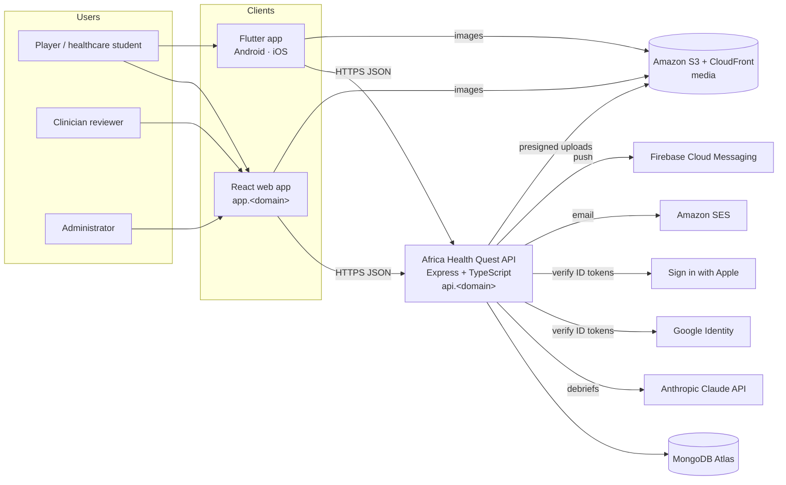
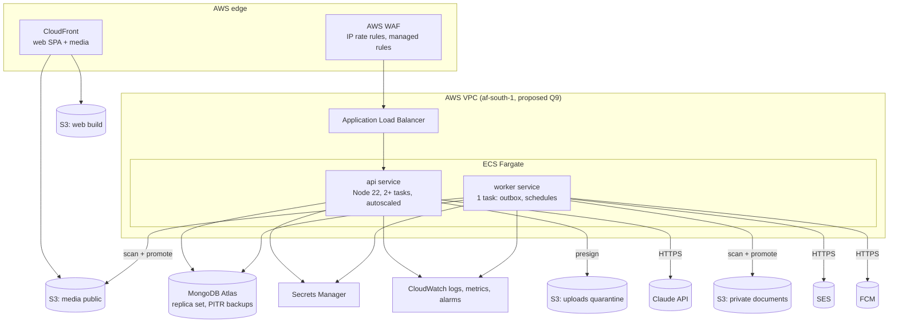
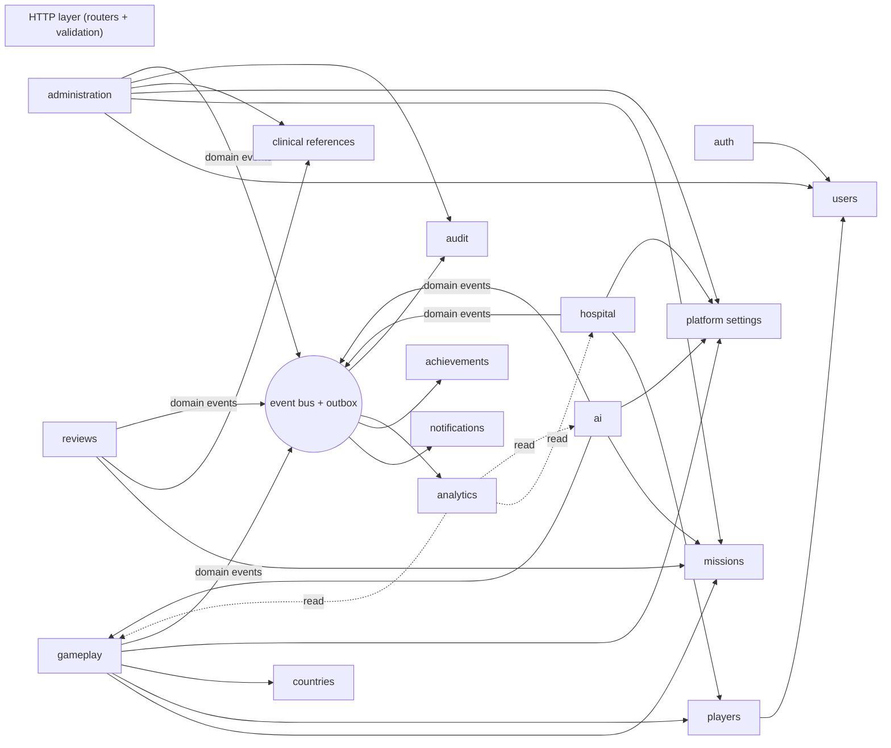
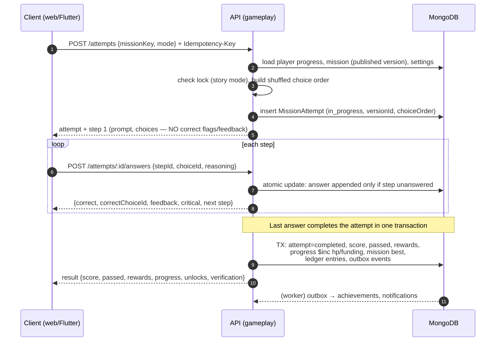
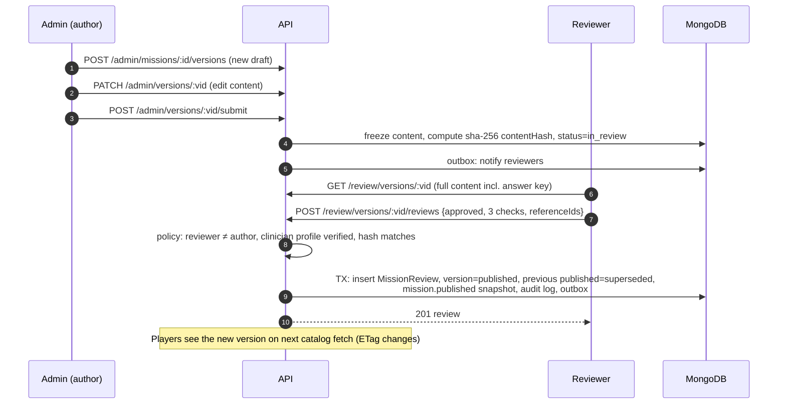

# System Architecture — Africa Health Quest

|                    |                                                                                                                                                      |
| ------------------ | ---------------------------------------------------------------------------------------------------------------------------------------------------- |
| **Status**         | Proposed — for review and approval (Phase 2 of the master plan)                                                                                      |
| **Date**           | 2026-11-03                                                                                                                                           |
| **Inputs**         | Approved audit (`TECHNICAL_AUDIT.md`, `FUNCTIONAL_REQUIREMENTS.md`, `TECHNICAL_RISKS.md`), decisions D1–D5, master project instructions              |
| **Companion docs** | `DATABASE_SCHEMA.md` · `API_SPECIFICATION.md` · `SECURITY_ARCHITECTURE.md` · `WEB_ARCHITECTURE.md` · `MOBILE_ARCHITECTURE.md` · `AI_ARCHITECTURE.md` |

## 1. Architectural principles

1. **One backend, many clients.** React web (players, reviewers, admins) and Flutter apps (Android, iOS) call the same
   versioned REST API (`/api/v1`). No client talks to the database, the AI provider or any third-party data service directly.
2. **Server-authoritative.** Express owns all business rules: answer evaluation, scoring, rewards, unlocks, random events,
   publication state. Clients render state and submit intents.
3. **Clinical answer keys never leave the server** except through reviewer/admin endpoints (permission-checked).
4. **Modular monolith.** One deployable API with strict module boundaries (§4). It is simpler to operate than
   microservices at this scale, and any module can be extracted later because modules communicate through service
   interfaces and domain events, not shared internals.
5. **Contract-first.** Request/response schemas live in `packages/api-contracts` (zod). They generate the OpenAPI document,
   the web client types and the Dart models.
6. **Configuration over code for game rules.** Economy, tiers, Commander events and AI quotas are versioned platform
   settings, so the product decisions Q1–Q12 become configuration values, not rewrites.
7. **Secure and private by default.** Least privilege, audit trails, data minimisation, no patient data.

## 2. System context



## 3. Containers and runtime components



| Component           | Responsibility                                                                                                                                                      | Scaling                                                                            |
| ------------------- | ------------------------------------------------------------------------------------------------------------------------------------------------------------------- | ---------------------------------------------------------------------------------- |
| **Web SPA**         | Player game, reviewer workspace, admin dashboard (lazy-loaded routes), static on S3 + CloudFront                                                                    | CDN                                                                                |
| **Flutter app**     | Player game on Android/iOS; offline catalog cache; push                                                                                                             | Client                                                                             |
| **API service**     | All HTTP endpoints, business rules, synchronous AI calls, authorization                                                                                             | Stateless; horizontal autoscaling on CPU and request count; min 2 tasks across AZs |
| **Worker service**  | Transactional outbox (email, push, notifications fan-out), scheduled jobs (guest purge, account deletion, retention, analytics roll-ups, upload scanning promotion) | 1 task; a leader lease in MongoDB prevents duplicate schedules if scaled           |
| **MongoDB Atlas**   | System of record; multi-document transactions for reward/publication flows                                                                                          | Replica set (3 nodes); analytics reads use `secondaryPreferred`                    |
| **S3 buckets**      | Web build; public media (mission images, flags, hero); upload quarantine; private documents (clinician credential evidence)                                         | —                                                                                  |
| **Secrets Manager** | JWT keys, Anthropic API key, SMTP/SES credentials, FCM service account, OAuth client secrets                                                                        | Rotation policies                                                                  |

The API and worker are **one codebase and one image** with two entrypoints (`server.js`, `worker.js`), sharing modules.

## 4. Backend module map



Detailed module contracts are in §8. Dependency rule: arrows point from a module to the services it may call. No
module touches another module's Mongoose models directly; it calls that module's service. Side effects that must not
block the request (push, email, achievements, notifications) go through **domain events persisted to an outbox in the
same transaction** and are processed by the worker.

### Layering inside each module

```
modules/<name>/
  <name>.routes.ts       HTTP: parse with contracts (zod), authorize, call service, map DTO
  <name>.service.ts      Use cases; transactions; emits domain events
  <name>.repository.ts   Mongoose queries and projections (the only place models are used)
  <name>.model.ts        Mongoose schema(s) owned by the module
  <name>.mapper.ts       Entity → DTO (whitelisting fields — answer keys stripped here)
  <name>.policy.ts       Authorization rules beyond role checks (ownership, state)
  domain/*.ts            Pure functions (scoring, unlock rules, hashing) — no I/O, unit-tested
```

## 5. Key flows

### 5.1 Playing a mission (server-authoritative)



### 5.2 Content publication (clinical governance)



### 5.3 Authentication and session refresh

See `SECURITY_ARCHITECTURE.md §2` (sequence diagram for login, rotation and reuse detection).

### 5.4 AI debrief

See `AI_ARCHITECTURE.md §3`.

## 6. Cross-cutting concerns

| Concern           | Design                                                                                                                                                                                            |
| ----------------- | ------------------------------------------------------------------------------------------------------------------------------------------------------------------------------------------------- |
| **API style**     | REST + JSON, `camelCase`, ISO-8601 UTC timestamps, ids as 24-hex strings, mission/country by stable keys; `/api/v1` versioning; additive changes only within a version                            |
| **Contracts**     | zod schemas in `packages/api-contracts` → OpenAPI 3.1 (`/openapi.json`, committed `docs/api/openapi.json`); CI fails on drift                                                                     |
| **Errors**        | Single envelope `{error:{code,message,details?,requestId}}`; code catalogue in `API_SPECIFICATION.md §3`                                                                                          |
| **Idempotency**   | `Idempotency-Key` header required on reward-bearing and AI mutations; stored 24 h (`idempotencyRecords`)                                                                                          |
| **Caching**       | Catalog endpoints return `ETag`; clients use `If-None-Match`; CloudFront caches media only (API responses are private)                                                                            |
| **Transactions**  | MongoDB multi-document transactions for attempt completion, hospital runs, review decisions, role changes with audit. Requires a replica set everywhere (Atlas; local/CI single-node replica set) |
| **Events**        | In-process domain events + transactional outbox (`outboxJobs`) → worker. At-least-once delivery; handlers idempotent                                                                              |
| **Configuration** | Environment (12-factor, zod-validated at boot) for infrastructure; `platformSettings` (versioned, audited) for game rules                                                                         |
| **Observability** | pino JSON logs with `requestId`, user id hash and route; CloudWatch metrics (latency, 4xx/5xx, AI latency/cost, outbox lag); alarms; error tracking (Sentry) for API, web and Flutter             |
| **Time**          | Server time is authoritative; all quotas reset at 00:00 UTC                                                                                                                                       |
| **Localisation**  | UI strings externalised (web i18next, Flutter ARB); content model has `locale` per mission version (English only at launch)                                                                       |
| **Accessibility** | WCAG 2.2 AA (web), Flutter semantics; enforced in reviews and automated checks                                                                                                                    |

## 7. Environments and delivery

| Environment  | Purpose                                                                                                                                    | Data               | AI                                                |
| ------------ | ------------------------------------------------------------------------------------------------------------------------------------------ | ------------------ | ------------------------------------------------- |
| `local`      | Developer machines (Docker Compose: MongoDB replica set, API, worker, web)                                                                 | Seeded content     | Real API key optional; fake provider by default   |
| `ci`         | GitHub Actions: lint, typecheck, unit/integration (real MongoDB replica set), contract drift, E2E (Playwright), Flutter tests, image build | Ephemeral          | Fake provider                                     |
| `staging`    | Pre-production on AWS, same topology at smaller size                                                                                       | Seeded + synthetic | Separate Anthropic workspace with low spend limit |
| `production` | Live                                                                                                                                       | Real               | Production workspace with spend limit and alarms  |

Pipeline: PR → CI gates → merge to `main` → build image once → deploy to staging automatically → smoke tests →
manual approval → production (ECS rolling deploy, health-check gated, automatic rollback). Web deploys are atomic S3
uploads + CloudFront invalidation. Mobile builds go to Play internal testing / TestFlight from tagged releases.
Infrastructure as code: AWS CDK in TypeScript (Q7, recommended).

## 8. Backend modules (responsibilities)

| Module                 | Responsibilities                                                                                                                                                                                   | Owns collections                                                                         | Main endpoints                                       |
| ---------------------- | -------------------------------------------------------------------------------------------------------------------------------------------------------------------------------------------------- | ---------------------------------------------------------------------------------------- | ---------------------------------------------------- |
| **auth** ✅            | Registration, email verification, login, Google + Apple ID-token sign-in, guest sessions and upgrade, refresh rotation, logout, password reset, sessions list/revoke, step-up re-auth, MFA (staff) | `userSessions`, `emailTokens`                                                            | `/auth/*`                                            |
| **users** ✅ (partial) | Identity record, profile basics, consent, account deletion/export requests, clinician profile (read)                                                                                               | `users`, `roles`                                                                         | `/users/me*`                                         |
| **players**            | Player profile (level, preferences), progress projection, ledger, learning stats, achievements earned                                                                                              | `playerProfiles`, `playerProgress`, `progressLedger`                                     | `/players/me/*`                                      |
| **countries**          | Country catalogue, unlock state                                                                                                                                                                    | `countries`                                                                              | `/countries*`                                        |
| **missions**           | Mission identities, versions, content hashing, publication state, player-safe projections, catalog ETag                                                                                            | `missions`, `missionVersions`                                                            | `/missions*`, `/catalog`                             |
| **gameplay**           | Attempts, answer evaluation, scoring (pure domain module), rewards, locks, Clinical Challenge practice mode, guest-merge replay                                                                    | `missionAttempts`                                                                        | `/attempts*`                                         |
| **hospital**           | Commander configuration, runs with server RNG, rewards                                                                                                                                             | `hospitalRuns`                                                                           | `/hospital/*`                                        |
| **ai**                 | Debrief generation (Claude), quotas, usage ledger, flags                                                                                                                                           | `aiDebriefs`, `aiUsageLogs`                                                              | `/attempts/:id/debriefs`, `/debriefs/*`, `/ai/quota` |
| **reviews**            | Reviewer workspace, decisions, policy (no self-approval, verified profile), publication transaction                                                                                                | `missionReviews`                                                                         | `/review/*`                                          |
| **references**         | Clinical reference library (reviewers/admins create; AI never)                                                                                                                                     | `clinicalReferences`                                                                     | `/review/references*`, `/admin/references*`          |
| **administration**     | Users/roles/disable, clinician verification, content authoring, settings, achievements catalogue, announcements, audit viewer                                                                      | (uses others' services)                                                                  | `/admin/*`                                           |
| **analytics**          | Aggregations and daily roll-ups for dashboards; mission quality (choice distributions)                                                                                                             | `analyticsDaily`                                                                         | `/admin/analytics/*`                                 |
| **notifications**      | In-app notifications, push via FCM, email via SES, device tokens, preferences                                                                                                                      | `notifications`, `deviceTokens`                                                          | `/notifications*`, `/devices*`                       |
| **achievements**       | Achievement catalogue, evaluation on domain events                                                                                                                                                 | `achievements` (+ embedded awards in `playerProgress`)                                   | via players/admin                                    |
| **media**              | Presigned uploads, scanning workflow, asset metadata                                                                                                                                               | `mediaAssets`                                                                            | `/uploads*`                                          |
| **platform**           | Settings (versioned), idempotency, rate-limit counters, outbox, audit log                                                                                                                          | `platformSettings`, `idempotencyRecords`, `rateLimitCounters`, `outboxJobs`, `auditLogs` | `/admin/settings*`                                   |

✅ = exists in the current codebase (commit `bbb130c`), see §10 for required changes.

## 9. Quality attributes

| Attribute     | Target                                                               | How                                                             |
| ------------- | -------------------------------------------------------------------- | --------------------------------------------------------------- |
| Availability  | 99.5 % monthly (API, web)                                            | Multi-AZ ECS, Atlas replica set, health-checked rolling deploys |
| Latency       | API p95 < 300 ms excluding AI; debrief p95 < 45 s (to be measured)   | Indexed queries, projections, no N+1, CDN for static            |
| Scalability   | 100 k registered players / 5 k concurrent in year 1 without redesign | Stateless API, Atlas vertical scaling, analytics on secondaries |
| Durability    | RPO ≤ 15 min, RTO ≤ 4 h                                              | Atlas continuous backup + PITR, quarterly restore drill         |
| Security      | OWASP ASVS L2                                                        | `SECURITY_ARCHITECTURE.md`                                      |
| Cost          | Predictable AI spend                                                 | Quotas + monthly budget cap (`AI_ARCHITECTURE.md §7`)           |
| Low bandwidth | Web initial JS < 200 KB gzip; API list payloads < 30 KB              | Code splitting, compact DTOs, ETags                             |

Capacity assumption for sizing: 100 k players × ~50 attempts/year ≈ 5 M attempts (~2 KB each ≈ 10 GB) — an Atlas
M20/M30 cluster is sufficient; start with M10 in staging.

## 10. Reconciliation with the already-built foundation

The foundation and authentication built before the audit remain valid; these changes are required by this architecture:

| Area           | Built today                                 | Change                                                                                                                                                  |
| -------------- | ------------------------------------------- | ------------------------------------------------------------------------------------------------------------------------------------------------------- |
| Refresh tokens | `RefreshToken` documents per token + family | Replace with `userSessions` (one document per session, current + recent token hashes) — enables "my devices", per-session revoke, device tokens linkage |
| Authorization  | `requireRole(...)`                          | Add permission-based `requirePermission(...)` resolved from `roles` collection; keep role checks as sugar                                               |
| Guest expiry   | MongoDB TTL index deletes guest users       | TTL cannot cascade → replace with scheduled purge job deleting guest user **and** related documents                                                     |
| Transactions   | Standalone MongoDB in compose/CI            | Single-node replica set locally and in CI (`--replSet rs0`)                                                                                             |
| Error codes    | 11 codes                                    | Add codes listed in `API_SPECIFICATION.md §3` (additive)                                                                                                |
| Rate limiting  | In-memory store                             | WAF for global IP limits + MongoDB-backed counters for auth/AI/answer limits                                                                            |
| Sign-in        | Email, Google                               | Add Sign in with Apple (App Store guideline 4.8) — decision A-3                                                                                         |
| Staff security | Same session policy for all                 | Shorter sessions + TOTP MFA + step-up re-auth for reviewers/admins — decision A-4                                                                       |
| Access token   | HS256 single secret                         | HS256 with `kid` header and two active keys for rotation                                                                                                |

## 11. Architecture decisions requiring approval

| #   | Decision                                                                                                                | Recommendation                                                                       |
| --- | ----------------------------------------------------------------------------------------------------------------------- | ------------------------------------------------------------------------------------ |
| A-1 | Modular monolith (API + worker from one codebase) vs microservices                                                      | Modular monolith                                                                     |
| A-2 | Admin and reviewer UIs inside the main web app (lazy routes) vs a separate app                                          | Same app, separate lazy bundles; server enforces permissions                         |
| A-3 | Add **Sign in with Apple** on iOS (App Store guideline 4.8 for apps offering third-party login)                         | Yes                                                                                  |
| A-4 | TOTP MFA mandatory for reviewer and admin roles                                                                         | Yes                                                                                  |
| A-5 | Default AI model `claude-opus-5-5`; cheaper models only after an evaluation shows equal quality (owner's cost decision) | See `AI_ARCHITECTURE.md §5`                                                          |
| A-6 | Shuffle answer order per attempt (correct answer is first in 15 of 17 steps today)                                      | Yes                                                                                  |
| A-7 | No Redis in v1: WAF for coarse limits, MongoDB counters for fine limits, MongoDB outbox instead of SQS                  | Yes; revisit at > 200 req/s sustained                                                |
| A-8 | Hosting region `af-south-1` + Atlas same region (Q9)                                                                    | Yes, subject to legal review of cross-border AI processing (`AI_ARCHITECTURE.md §9`) |

Product decisions Q1–Q12 from the audit are modelled as **configuration** with the audit's recommended defaults
(`DATABASE_SCHEMA.md §platformSettings`); the owner can change them without code changes.
