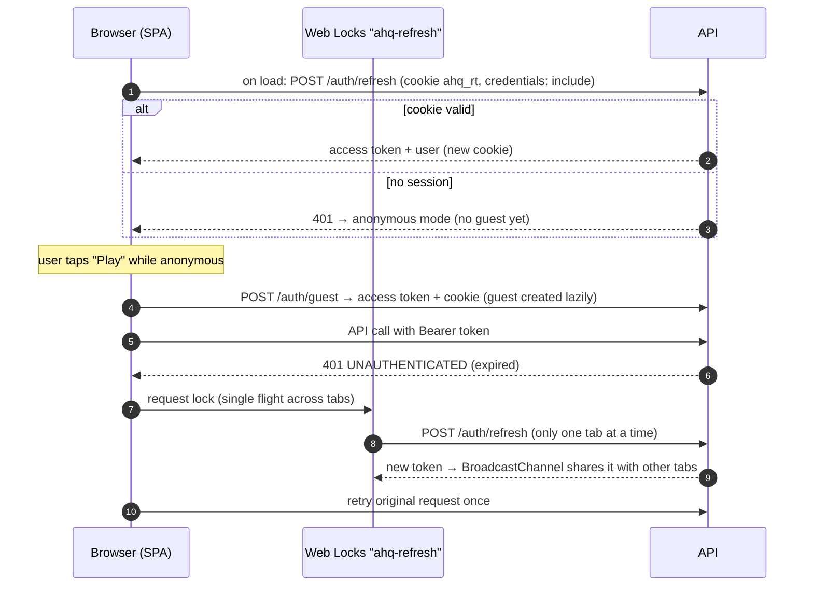

# Web Architecture — React + Vite + TypeScript

|               |                                                                                                                   |
| ------------- | ----------------------------------------------------------------------------------------------------------------- |
| **Status**    | Proposed — for approval                                                                                           |
| **Location**  | `apps/web` in the monorepo                                                                                        |
| **Audiences** | Players (game), clinician reviewers (`/review`), administrators (`/admin`) — one app, separately code-split (A-2) |

## 1. Technology choices

| Concern          | Choice                                                                                                                       | Why                                                                     |
| ---------------- | ---------------------------------------------------------------------------------------------------------------------------- | ----------------------------------------------------------------------- |
| Build            | Vite + React 19 + TypeScript (strict)                                                                                        | Required stack; fast builds                                             |
| Routing          | React Router 8 (data router: `createBrowserRouter`, lazy routes)                                                             | Mature, nested layouts, route-level code splitting and loaders          |
| Server state     | TanStack Query 5                                                                                                             | Caching, retries, background refresh, optimistic updates, offline-aware |
| Client state     | Zustand stores for client-only state (session/access token in memory, UI preferences); React state for local component state | Server data stays in TanStack Query; Zustand never caches server data   |
| Forms            | react-hook-form + zod resolvers using `@ahq/api-contracts` schemas                                                           | Same validation as the API                                              |
| UI               | Tailwind CSS 4 with the prototype's tokens; custom game components; shadcn/ui (Radix) for reviewer/admin screens             | Preserves visual identity; accessible primitives                        |
| API client       | Thin typed `fetch` wrapper + types from `@ahq/api-contracts` (zod schemas parse responses in dev/test)                       | No generated runtime bloat; shared types                                |
| i18n             | i18next + react-i18next, namespaces per feature, English at launch                                                           | NFR-10                                                                  |
| Charts (admin)   | Recharts (already familiar from prototype deps)                                                                              | Admin dashboards only, lazy-loaded                                      |
| Testing          | Vitest + React Testing Library + MSW (API mocks); Playwright E2E against the real API in CI                                  | —                                                                       |
| Errors/telemetry | Sentry (browser) with PII scrubbing                                                                                          | Production diagnostics                                                  |
| PWA              | `vite-plugin-pwa`: precache app shell, runtime-cache `/catalog` and media; offline page                                      | Low-connectivity resilience (read-only offline)                         |

## 2. Project structure

```
apps/web/
  index.html
  src/
    main.tsx                     bootstraps providers, router
    app/
      router.tsx                 route tree (lazy feature routes)
      providers.tsx              QueryClient, AuthProvider, I18n, Theme, ErrorBoundary
      layouts/GameLayout.tsx     kente strip, header (HP, funding, account), tier card
      layouts/StaffLayout.tsx    sidebar layout for /review and /admin (shadcn)
    lib/
      api/client.ts              fetch wrapper: base URL, auth header, refresh single-flight, error mapping
      api/errors.ts              ApiError (code, status, details, requestId) + user messages
      api/queryKeys.ts           central query key factory
      auth/                      AuthProvider, token store (memory), refresh lock, guards
      i18n/, format/, analytics/
    components/
      game/                      Header, TierCard, ModeButton, MissionCard, ChoiceButton, FeedbackPanel,
                                 ResultCard, VerificationBox, ResourceStepper, CountryCard, KenteStrip
      ui/                        shadcn components actually used (generated on demand)
    features/
      home/  story/  play/  clinical/  commander/  countries/  debrief/  account/
      notifications/  review/  admin/{users,content,settings,ai,analytics,audit,references}
        each: routes.tsx, api.ts (queries/mutations), components/, hooks/, *.test.tsx
    theme/tokens.css             design tokens from SCREEN_INVENTORY (contrast-adjusted per Q10)
    locales/en/*.json
  e2e/                           Playwright specs
```

## 3. Navigation (routes)

| Path                                                                    | Screen (SCREEN_INVENTORY id)                                                         | Access                              |
| ----------------------------------------------------------------------- | ------------------------------------------------------------------------------------ | ----------------------------------- |
| `/`                                                                     | Home SC-01                                                                           | Public                              |
| `/story`                                                                | Mission list SC-02                                                                   | Public (locks shown when signed in) |
| `/play/:attemptId`                                                      | Mission play SC-03/04/05 + debrief SC-06                                             | Player (owner)                      |
| `/missions/:key`                                                        | Mission intro (starts or resumes an attempt)                                         | Public → creates guest lazily       |
| `/clinical`                                                             | Clinical Challenge SC-07                                                             | Public                              |
| `/commander`                                                            | Hospital Commander SC-08/09                                                          | Player                              |
| `/countries`                                                            | Countries SC-10                                                                      | Public                              |
| `/account`, `/account/sign-in`, `/account/sign-up`, `/account/security` | SC-11/12, sessions, MFA, export/delete                                               | —                                   |
| `/verify-email`, `/reset-password`, `/forgot-password`                  | Email link landings                                                                  | Public                              |
| `/notifications`                                                        | Notification centre                                                                  | Player                              |
| `/review/*`                                                             | Queue, version review (SC-14/15), references, flagged debriefs                       | `review:read`                       |
| `/admin/*`                                                              | Users, content editor, countries, achievements, settings, AI usage, analytics, audit | Admin                               |
| `*`                                                                     | Themed 404                                                                           | Public                              |

Every in-game view is a real URL, fixing the prototype's lost-on-refresh and Back-button problems. Route guards
redirect unauthenticated users to sign-in with a `returnTo` parameter; the server remains the enforcement point.

## 4. State management

| State                                                                 | Where                                                                                                       |
| --------------------------------------------------------------------- | ----------------------------------------------------------------------------------------------------------- |
| Session (user, roles, access token)                                   | `AuthProvider` context; access token in memory only                                                         |
| Server data (catalog, progress, attempts, notifications, admin lists) | TanStack Query cache, keyed by `queryKeys`                                                                  |
| Mission play                                                          | `useReducer` in `features/play` driven by API responses (current step, last answer reveal, reasoning draft) |
| Reasoning draft                                                       | `sessionStorage` per attempt+step (survives refresh, cleared on submit) — try/catch guarded                 |
| UI preferences                                                        | `localStorage` (locale, dismissed tips) — never game state                                                  |

Cache rules: `/catalog` stale-time 10 min with ETag revalidation; progress invalidated after answer/run responses
(and set directly from `result.progress` to avoid an extra request); admin lists stale-time 30 s.

## 5. Authentication flow (web)



- Guests are created **lazily** on the first action that needs an identity (start mission, Commander), not on page
  load — avoids bot-created guests.
- Signing in from a guest session sends `guestAccessToken` so progress is merged server-side.
- Staff sign-in: if `mfaRequired`, the app routes to the TOTP challenge before staff routes become available;
  step-up prompts are handled by intercepting `401 STEP_UP_REQUIRED` and opening a re-authentication dialog, then
  replaying the request.
- Google: Google Identity Services button → ID token → `/auth/google`. Apple: Sign in with Apple JS (web) → `/auth/apple`.

## 6. Error handling

| Layer            | Behaviour                                                                                                                                                                                                                                                                                                                     |
| ---------------- | ----------------------------------------------------------------------------------------------------------------------------------------------------------------------------------------------------------------------------------------------------------------------------------------------------------------------------- |
| API client       | Maps the error envelope to `ApiError`; retries idempotent GETs on network errors/5xx (exponential, max 2); never retries non-idempotent requests without an `Idempotency-Key` (reward and AI mutations always send one and may retry safely)                                                                                  |
| Error codes → UX | `VALIDATION_ERROR` → field errors; `RATE_LIMITED`/`QUOTA_EXCEEDED` → friendly message with reset time; `MISSION_LOCKED` → unlock hint; `AI_UNAVAILABLE` → "Debriefs are resting — try later"; `ATTEMPT_NOT_ACTIVE` → reload attempt; `UNAUTHENTICATED` → refresh flow; `INTERNAL` → generic message + `requestId` for support |
| Rendering        | Route-level error boundaries (themed "This page didn't load" with retry), global boundary, Suspense skeletons                                                                                                                                                                                                                 |
| Offline          | `navigator.onLine` + query failures → offline banner; play actions disabled with explanation (answers need the server)                                                                                                                                                                                                        |
| Telemetry        | Sentry captures unhandled errors with `requestId`, without PII or reasoning text                                                                                                                                                                                                                                              |

## 7. Offline and synchronisation (web)

The web app is **online-first with read-only offline**: the PWA service worker caches the shell, `/catalog`, the last
progress snapshot and media, so Home, Story list, Countries and past results render offline. Mutations are not queued
on web (answers need server evaluation; other mutations are rare). Progress is always re-fetched from the server
after reconnecting, so there is nothing to merge.

## 8. Performance and accessibility budgets

| Budget                   | Target                                                                                                                                                                                                                                    |
| ------------------------ | ----------------------------------------------------------------------------------------------------------------------------------------------------------------------------------------------------------------------------------------- |
| Initial JS (game routes) | < 200 KB gzip; `/review` and `/admin` in separate lazy chunks                                                                                                                                                                             |
| LCP                      | < 2.5 s on mid-range Android, slow 4G profile                                                                                                                                                                                             |
| Hero image               | ≤ 60 KB WebP/AVIF responsive set (`srcset`)                                                                                                                                                                                               |
| Fonts                    | Self-hosted, subset Latin, `font-display: swap`, 2 families                                                                                                                                                                               |
| Accessibility            | WCAG 2.2 AA: text alternatives for emoji/flags, focus styles on `btn-game`, visible disabled state, labels on all inputs, correctness not by colour alone (✔/✗ icons + text), reduced-motion support, header that never wraps at ≥ 360 px |
| Checks                   | Lighthouse CI budgets and axe-core in Playwright on every PR                                                                                                                                                                              |

## 9. Deployment

Static build → S3 (versioned, immutable hashed assets with 1-year cache; `index.html` no-cache) → CloudFront with
security headers (CSP, HSTS) via response headers policy. Environment config (`API_BASE_URL`, Google client id,
Sentry DSN) injected at build time per environment; no secrets in the bundle.
