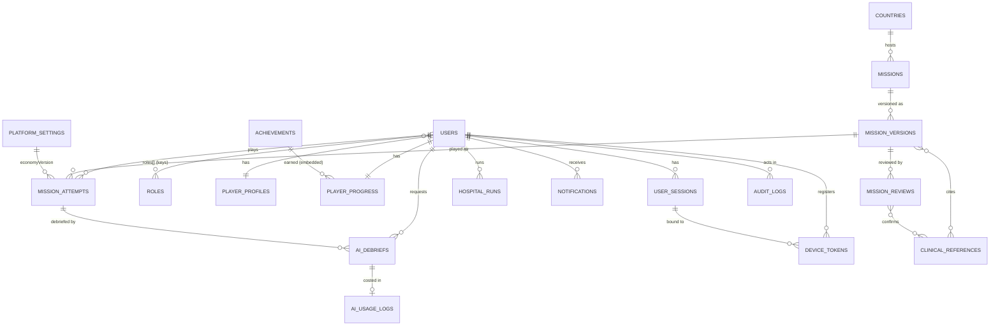
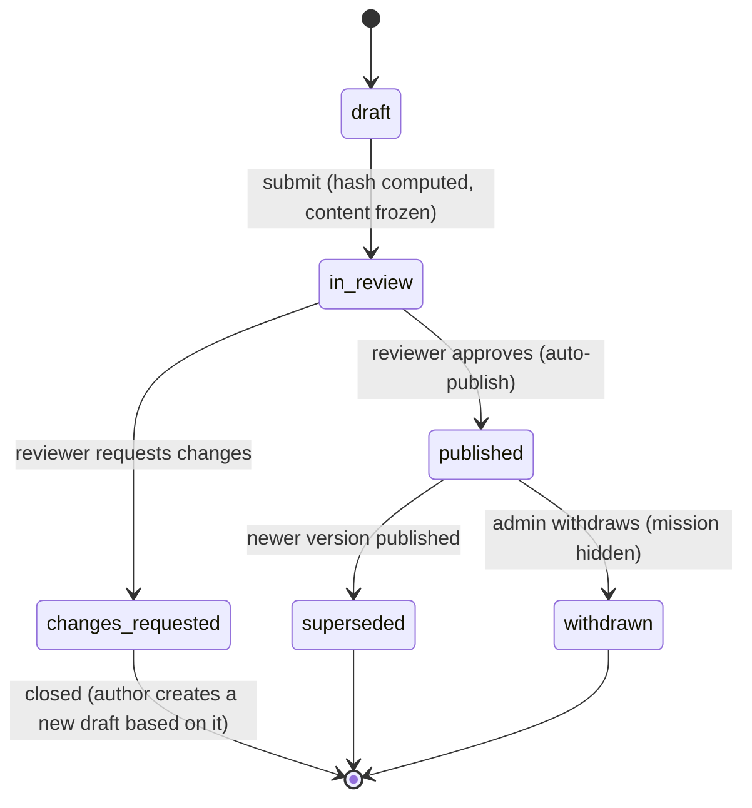

# Database Schema — MongoDB (Mongoose)

|              |                                                                                               |
| ------------ | --------------------------------------------------------------------------------------------- |
| **Status**   | Proposed — for approval                                                                       |
| **Database** | One MongoDB database per environment (`ahq_<env>`), MongoDB 7+, Atlas replica set             |
| **ODM**      | Mongoose 8, `strict: true`, `strictQuery: true`, timestamps on every collection unless stated |

## 1. Conventions

| Topic             | Convention                                                                                                                                                                                                                                 |
| ----------------- | ------------------------------------------------------------------------------------------------------------------------------------------------------------------------------------------------------------------------------------------ |
| Collection names  | camelCase plural (`missionVersions`); Mongoose model names singular PascalCase (`MissionVersion`)                                                                                                                                          |
| Identifiers       | `_id: ObjectId` everywhere; human-stable **keys** where content is referenced by clients: `missions.key` (slug, e.g. `malaria`), `countries.code` (ISO 3166-1 alpha-2, e.g. `NG`), `achievements.key`, `roles.key`, `platformSettings.key` |
| Timestamps        | `createdAt`, `updatedAt` (Mongoose `timestamps`), UTC `Date`                                                                                                                                                                               |
| Money / currency  | In-game funding is an integer of "Health Credits" (no real money). AI cost stored as integer **micro-USD**                                                                                                                                 |
| Enums             | Validated by Mongoose `enum` **and** by zod at the API boundary                                                                                                                                                                            |
| Validation layers | (1) zod at the API edge, (2) Mongoose schema validators, (3) MongoDB `$jsonSchema` validators on reward-critical collections (`playerProgress`, `missionAttempts`, `hospitalRuns`, `missionReviews`) as a last line of defence             |
| Deletes           | Hard deletes only for expiring/system data; user-owned data deleted by the account-deletion job (§5)                                                                                                                                       |
| Immutability      | `missionVersions` content after submission, `missionReviews`, `progressLedger`, `auditLogs`, `aiUsageLogs` are append-only; enforced in repositories and by pre-update hooks that reject changes                                           |
| Text limits       | All strings have explicit `maxlength`; arrays explicit maximum sizes                                                                                                                                                                       |

**Access legend** used in every collection:
`Public` (no auth) · `Player` (any signed-in user incl. guest, own data only) · `Registered` (non-guest) ·
`Reviewer` · `Admin` · `System` (API/worker internal only, never exposed directly).
Database-level: the API and worker use a MongoDB user with `readWrite` on the application database only; analytics
queries use a read-only user on secondaries; no human has production write access except audited break-glass.

## 2. Entity relationships



## 3. Embed vs reference

| Data                                                             | Decision                                                                                  | Reason                                                                                                                                                   |
| ---------------------------------------------------------------- | ----------------------------------------------------------------------------------------- | -------------------------------------------------------------------------------------------------------------------------------------------------------- |
| Steps and choices inside a mission version                       | **Embed** in `missionVersions.content`                                                    | Read together, bounded (≤ 10 steps × ≤ 6 choices), immutable after submission, hashed as one unit                                                        |
| Mission → versions                                               | **Reference** (`missionVersions.missionId`)                                               | Unbounded history; versions read individually                                                                                                            |
| Published version summary on mission (title, icon, verification) | **Embed snapshot** in `missions.published`                                                | Catalog lists need one query; updated in the publication transaction                                                                                     |
| Per-mission player stats (best score, attempts, passed)          | **Embed map** in `playerProgress.missions.<key>`                                          | Bounded by catalog size; enables atomic `$max`/`$inc`; one read for the Story list. Split into its own collection if the catalog exceeds ~2 000 missions |
| Answers within an attempt                                        | **Embed** in `missionAttempts.answers`                                                    | Bounded by steps; written atomically per step                                                                                                            |
| Attempts per player                                              | **Reference** (`missionAttempts.userId`)                                                  | Unbounded                                                                                                                                                |
| Progress change history                                          | **Reference** collection `progressLedger`                                                 | Unbounded, append-only, audit                                                                                                                            |
| Earned achievements                                              | **Embed** in `playerProgress.achievements`                                                | Bounded by achievement catalogue                                                                                                                         |
| Reviewer identity on a review                                    | **Reference** `reviewerId` + **embed snapshot** (`reviewer.name`, `reviewer.credentials`) | History must show what was true at review time                                                                                                           |
| References on versions/reviews                                   | **Reference** ids to `clinicalReferences`                                                 | Shared library, reused across missions, independently curated                                                                                            |
| Role definitions                                                 | **Reference** collection `roles`; **embed role keys** on `users.roles`                    | Fast authorization without join; definitions editable centrally                                                                                          |
| Clinician profile                                                | **Embed** in `users.clinician`                                                            | 1:1, small, needed with authorization checks                                                                                                             |
| Debrief flags                                                    | **Embed** in `aiDebriefs.flags`                                                           | Only the owner can flag; tiny and bounded (max 5)                                                                                                        |
| Session device info                                              | **Embed** in `userSessions.device`                                                        | 1:1                                                                                                                                                      |
| Economy constants used by an attempt                             | **Reference** by `economyVersion`                                                         | Reproducibility without copying settings                                                                                                                 |

## 4. Collections

> Field tables list type, requirement (**R** required, O optional, S system-managed) and validation.

### 4.1 `users` — identity and authentication _(exists; changes marked ▲)_

| Field                    | Type                                                                                                                                                                                                                                                             | Req | Validation / notes                                                                        |
| ------------------------ | ---------------------------------------------------------------------------------------------------------------------------------------------------------------------------------------------------------------------------------------------------------------- | --- | ----------------------------------------------------------------------------------------- |
| `email`                  | String                                                                                                                                                                                                                                                           | O   | lowercase, trimmed, ≤ 254, RFC email; unique (partial: string) ; absent for guests        |
| `emailVerifiedAt`        | Date \| null                                                                                                                                                                                                                                                     | S   |                                                                                           |
| `passwordHash`           | String                                                                                                                                                                                                                                                           | O   | `select:false`; `scrypt$N$r$p$salt$hash`                                                  |
| `googleSub`              | String                                                                                                                                                                                                                                                           | O   | unique (partial)                                                                          |
| `appleSub` ▲             | String                                                                                                                                                                                                                                                           | O   | unique (partial)                                                                          |
| `displayName`            | String                                                                                                                                                                                                                                                           | R   | 1–60 chars, trimmed                                                                       |
| `roles`                  | [String]                                                                                                                                                                                                                                                         | R   | each ∈ `roles.key`; always contains `player`; max 5                                       |
| `isGuest`                | Boolean                                                                                                                                                                                                                                                          | R   | default false                                                                             |
| `guestLastActiveAt` ▲    | Date                                                                                                                                                                                                                                                             | O   | replaces TTL field `guestExpiresAt`; purge job deletes guests inactive > `GUEST_TTL_DAYS` |
| `disabledAt`             | Date \| null                                                                                                                                                                                                                                                     | O   | blocks sign-in and all requests                                                           |
| `lastLoginAt`            | Date                                                                                                                                                                                                                                                             | O   |                                                                                           |
| `mfa` ▲                  | { totpSecretEnc: String, enabledAt: Date, recoveryCodeHashes: [String] ≤ 10 }                                                                                                                                                                                    | O   | secret envelope-encrypted (KMS); required for reviewer/admin (A-4)                        |
| `clinician` ▲            | { fullName ≤ 120, credentials ≤ 200, profession enum[doctor, nurse, midwife, pharmacist, clinical_officer, other], registrationBody ≤ 120, registrationNumberEnc String, countryCode, evidenceAssetIds [ObjectId] ≤ 5, verifiedAt, verifiedBy: ObjectId(users) } | O   | Set/verified only by admins; required before a reviewer may decide                        |
| `consent` ▲              | { termsVersion, privacyVersion, acceptedAt, aiProcessingAcceptedAt }                                                                                                                                                                                             | O   | Required for registered users before AI use                                               |
| `deletion` ▲             | { requestedAt, scheduledFor }                                                                                                                                                                                                                                    | O   | Account-deletion workflow                                                                 |
| `createdAt`, `updatedAt` | Date                                                                                                                                                                                                                                                             | S   |                                                                                           |

**Indexes:** `{email:1}` unique partial · `{googleSub:1}` unique partial · `{appleSub:1}` unique partial · `{roles:1}` ·
`{isGuest:1, guestLastActiveAt:1}` (purge) · `{"deletion.scheduledFor":1}` sparse.
**Access:** Player — own record via `/users/me` (no hashes/secrets ever returned) · Admin — read/search, roles, disable,
clinician verification · System — auth.

### 4.2 `userSessions` — one document per signed-in device _(replaces `refreshtokens`)_

| Field                 | Type                                                                               | Req | Validation / notes                                  |
| --------------------- | ---------------------------------------------------------------------------------- | --- | --------------------------------------------------- |
| `userId`              | ObjectId → users                                                                   | R   |                                                     |
| `currentTokenHash`    | String                                                                             | R   | SHA-256 of the current opaque refresh token; unique |
| `previousTokenHashes` | [String]                                                                           | S   | last 5 rotated hashes (reuse detection)             |
| `rotatedAt`           | Date                                                                               | S   |                                                     |
| `device`              | { platform enum[web, android, ios], userAgent ≤ 300, appVersion ≤ 20, name ≤ 60 }  | R   |                                                     |
| `ipHash`              | String                                                                             | O   | HMAC-SHA-256 of IP with rotating key                |
| `mfaVerifiedAt`       | Date                                                                               | O   |                                                     |
| `authenticatedAt`     | Date                                                                               | R   | last full sign-in (step-up check)                   |
| `lastUsedAt`          | Date                                                                               | S   |                                                     |
| `idleExpiresAt`       | Date                                                                               | R   | sliding: players 30 d, staff 12 h                   |
| `absoluteExpiresAt`   | Date                                                                               | R   | players 180 d, staff 7 d                            |
| `revokedAt`           | Date \| null                                                                       | S   |                                                     |
| `revokedReason`       | enum[logout, logout_all, reuse_detected, password_reset, admin, disabled, expired] | O   |                                                     |

**Indexes:** `{currentTokenHash:1}` unique · `{previousTokenHashes:1}` · `{userId:1, revokedAt:1}` ·
`{absoluteExpiresAt:1}` TTL (expireAfterSeconds 0) — sessions are leaf data, so TTL is safe here.
**Access:** Player — list/revoke own sessions (`/auth/sessions`) · Admin — revoke a user's sessions · System.

### 4.3 `roles` — role catalogue and permissions

| Field                 | Type                                     | Req | Validation / notes                                               |
| --------------------- | ---------------------------------------- | --- | ---------------------------------------------------------------- |
| `key`                 | String                                   | R   | unique; `player` \| `reviewer` \| `admin` (system roles, seeded) |
| `name`, `description` | String                                   | R   | ≤ 60 / ≤ 300                                                     |
| `permissions`         | [String]                                 | R   | ∈ permission catalogue (`SECURITY_ARCHITECTURE.md §4`)           |
| `system`              | Boolean                                  | R   | system roles cannot be deleted; v1 has no custom roles           |
| `sessionPolicy`       | { idleHours, absoluteDays, mfaRequired } | R   | stricter policy wins when a user has several roles               |

**Indexes:** `{key:1}` unique. **Access:** Admin read; changes only by migration in v1 (audited). Cached in API memory,
refreshed on change event.

### 4.4 `playerProfiles` — game persona and preferences

| Field               | Type                                                                                                                              | Req | Validation / notes                                  |
| ------------------- | --------------------------------------------------------------------------------------------------------------------------------- | --- | --------------------------------------------------- |
| `userId`            | ObjectId → users                                                                                                                  | R   | unique                                              |
| `learnerLevel`      | enum[nursing_student, medical_student, midwifery_student, pharmacy_student, intern_junior_doctor, community_health_worker, other] | O   | default for debrief level picker                    |
| `institution`       | String                                                                                                                            | O   | ≤ 120, optional, free text                          |
| `homeCountryCode`   | String                                                                                                                            | O   | ISO alpha-2                                         |
| `locale`            | String                                                                                                                            | R   | BCP-47, default `en`                                |
| `avatarAssetId`     | ObjectId → mediaAssets                                                                                                            | O   |                                                     |
| `notificationPrefs` | { push: Boolean, email: Boolean, types: { [type]: Boolean } }                                                                     | R   | defaults: push true, email false (staff email true) |
| `onboarding`        | { completedAt, tutorialStep }                                                                                                     | O   |                                                     |

**Indexes:** `{userId:1}` unique. **Access:** Player own (read/update) · Admin read · deleted with user.

### 4.5 `playerProgress` — authoritative game state projection (one per user)

| Field                  | Type                                                                                                                                      | Req | Validation / notes                                                     |
| ---------------------- | ----------------------------------------------------------------------------------------------------------------------------------------- | --- | ---------------------------------------------------------------------- |
| `userId`               | ObjectId → users                                                                                                                          | R   | unique                                                                 |
| `hp`                   | Int                                                                                                                                       | R   | ≥ 0, default `economy.startingHp` (0)                                  |
| `funding`              | Int                                                                                                                                       | R   | ≥ 0, default `economy.startingFunding` (100) — `$jsonSchema` minimum 0 |
| `tierIndex`            | Int                                                                                                                                       | S   | derived from hp on every change                                        |
| `unlockedCountryCodes` | [String]                                                                                                                                  | S   | derived; cached for listing                                            |
| `missions`             | Map\<missionKey, { bestScore Int, maxScore Int, attempts Int, passed Bool, firstPassedAt Date, lastPlayedAt Date, practiceAttempts Int }> | S   | updated with `$max`/`$inc`/`$set` atomically                           |
| `stats`                | { storyCompleted, practiceCompleted, shiftsRun, debriefsGenerated, perfectScores } Ints                                                   | S   |                                                                        |
| `achievements`         | [{ key, earnedAt }]                                                                                                                       | S   | ≤ catalogue size; unique keys                                          |
| `version`              | Int                                                                                                                                       | S   | optimistic concurrency counter (incremented on every change)           |

**Indexes:** `{userId:1}` unique · `{hp:-1}` (future leaderboards/analytics).
**Access:** Player read own; **no client write path** — mutated only by gameplay/hospital/achievement services inside
transactions · Admin read · System.

### 4.6 `progressLedger` _(supporting)_ — append-only record of every progress change

| Field            | Type                                                                            | Req | Notes |
| ---------------- | ------------------------------------------------------------------------------- | --- | ----- |
| `userId`         | ObjectId                                                                        | R   |       |
| `source`         | enum[mission_attempt, hospital_run, guest_merge, admin_adjustment, achievement] | R   |       |
| `sourceId`       | ObjectId                                                                        | R   |       |
| `delta`          | { hp Int, funding Int }                                                         | R   |       |
| `balanceAfter`   | { hp Int, funding Int }                                                         | R   |       |
| `economyVersion` | Int                                                                             | R   |       |
| `createdAt`      | Date                                                                            | S   |       |

**Indexes:** `{userId:1, createdAt:-1}` · `{source:1, sourceId:1}` unique (prevents double-award).
**Access:** Player read own (`/players/me/ledger`) · Admin read · System write.

### 4.7 `countries`

| Field          | Type                                       | Req | Validation / notes                               |
| -------------- | ------------------------------------------ | --- | ------------------------------------------------ |
| `code`         | String                                     | R   | ISO 3166-1 alpha-2 uppercase; unique             |
| `name`         | String                                     | R   | ≤ 80                                             |
| `translations` | Map\<locale, { name }>                     | O   |                                                  |
| `flagAssetId`  | ObjectId → mediaAssets                     | O   | SVG flag (emoji fallback `flagEmoji`)            |
| `flagEmoji`    | String                                     | O   |                                                  |
| `focus`        | String                                     | R   | ≤ 160 (e.g. "Malaria, sickle cell, road trauma") |
| `unlockHp`     | Int                                        | R   | ≥ 0                                              |
| `status`       | enum[active, coming_soon, hidden]          | R   |                                                  |
| `sortOrder`    | Int                                        | R   |                                                  |
| `region`       | enum[west, east, central, southern, north] | O   |                                                  |

Seed: NG 0, GH 100, KE 250, ZA 450, ET 650 (verbatim focus text).
**Indexes:** `{code:1}` unique · `{status:1, sortOrder:1}`. **Access:** Public read (active/coming_soon) · Admin write (audited).

### 4.8 `missions` — stable identity, placement and publication pointer

| Field                 | Type                                                                                                                                         | Req | Validation / notes                                                                  |
| --------------------- | -------------------------------------------------------------------------------------------------------------------------------------------- | --- | ----------------------------------------------------------------------------------- |
| `key`                 | String                                                                                                                                       | R   | slug `^[a-z0-9-]{2,40}$`, unique, immutable (prototype ids: `malaria`, `sickle`, …) |
| `countryCode`         | String → countries.code                                                                                                                      | R   |                                                                                     |
| `tier`                | Int                                                                                                                                          | R   | 0–(tiers−1); gameplay placement, not clinical content                               |
| `icon`                | String                                                                                                                                       | R   | emoji or asset key, ≤ 16                                                            |
| `sortOrder`           | Int                                                                                                                                          | R   |                                                                                     |
| `topics`              | [String]                                                                                                                                     | O   | ≤ 10, each ≤ 40 (filters)                                                           |
| `status`              | enum[draft, published, withdrawn, retired]                                                                                                   | R   | `draft` until first approval                                                        |
| `publishedVersionId`  | ObjectId → missionVersions                                                                                                                   | O   |                                                                                     |
| `published`           | { versionId, versionNumber, title, stepCount, maxScore, contentHash, verification: { reviewerName, credentials, approvedAt, referenceIds } } | O   | snapshot updated in publication TX                                                  |
| `latestVersionNumber` | Int                                                                                                                                          | S   |                                                                                     |
| `openDraftVersionId`  | ObjectId                                                                                                                                     | O   | at most one open draft                                                              |
| `createdBy`           | ObjectId → users                                                                                                                             | R   |                                                                                     |

**Indexes:** `{key:1}` unique · `{status:1, countryCode:1, tier:1, sortOrder:1}` · `{topics:1}`.
**Access:** Public/Player read **published only** (projection without answer data — it holds none) · Reviewer read all ·
Admin write (placement fields audited; changing `countryCode` forces a new version review — see 4.9).

### 4.9 `missionVersions` — immutable, reviewable clinical content

| Field                                                      | Type                                                                                  | Req | Validation / notes                                                                     |
| ---------------------------------------------------------- | ------------------------------------------------------------------------------------- | --- | -------------------------------------------------------------------------------------- |
| `missionId`                                                | ObjectId → missions                                                                   | R   |                                                                                        |
| `versionNumber`                                            | Int                                                                                   | R   | 1..n per mission; unique with missionId                                                |
| `status`                                                   | enum[draft, in_review, changes_requested, approved, published, superseded, withdrawn] | R   | state machine below                                                                    |
| `locale`                                                   | String                                                                                | R   | default `en`                                                                           |
| `content.title`                                            | String                                                                                | R   | ≤ 80                                                                                   |
| `content.story`                                            | String                                                                                | R   | ≤ 2 000                                                                                |
| `content.countryCode`                                      | String                                                                                | R   | copied from mission at draft creation; part of the hash (guidelines differ by country) |
| `content.learningObjectives`                               | [String]                                                                              | O   | ≤ 5 × ≤ 200                                                                            |
| `content.steps`                                            | [Step]                                                                                | R   | 1–10                                                                                   |
| `Step.stepId`                                              | String                                                                                | R   | `s1`…; stable within version                                                           |
| `Step.prompt`                                              | String                                                                                | R   | ≤ 300                                                                                  |
| `Step.choices`                                             | [Choice]                                                                              | R   | 2–6; **exactly one `correct: true`** (validator)                                       |
| `Choice.choiceId`                                          | String                                                                                | R   | `s1c1`…                                                                                |
| `Choice.text`                                              | String                                                                                | R   | ≤ 200                                                                                  |
| `Choice.correct`                                           | Boolean                                                                               | R   | **answer key — never in player DTOs**                                                  |
| `Choice.feedback`                                          | String                                                                                | R   | ≤ 500                                                                                  |
| `Choice.critical`                                          | Boolean                                                                               | O   | clinician-flagged dangerous choice (Q5)                                                |
| `referenceIds`                                             | [ObjectId → clinicalReferences]                                                       | O   | ≤ 10, suggested by author, confirmed by reviewer                                       |
| `contentHash`                                              | String                                                                                | S   | sha-256 hex of canonical JSON of `content` + sorted `referenceIds`; computed on submit |
| `authoredBy`                                               | [ObjectId → users]                                                                    | R   | everyone who edited the draft (self-approval check)                                    |
| `submittedAt`, `approvedAt`, `publishedAt`, `supersededAt` | Date                                                                                  | S   |                                                                                        |
| `basedOnVersionId`                                         | ObjectId                                                                              | O   |                                                                                        |
| `changeSummary`                                            | String                                                                                | O   | ≤ 500                                                                                  |



`approved` is an internal transient state inside the publication transaction (kept in the enum for a future
"approve now, publish later" option).

**Indexes:** `{missionId:1, versionNumber:-1}` unique · `{status:1, submittedAt:1}` (review queue) · `{contentHash:1}`.
**Access:** Player — **never directly**; gameplay reads via projections that exclude `correct`, `feedback`, `critical`
until the step is answered · Reviewer read all · Admin create/edit **draft only** · System.
**Immutability:** pre-`updateOne`/`save` hooks reject any change to `content` or `referenceIds` unless `status=draft`.

### 4.10 `missionAttempts`

| Field                      | Type                                                                     | Req | Validation / notes                                         |
| -------------------------- | ------------------------------------------------------------------------ | --- | ---------------------------------------------------------- |
| `userId`                   | ObjectId → users                                                         | R   |                                                            |
| `missionId`, `missionKey`  | ObjectId, String                                                         | R   |                                                            |
| `missionVersionId`         | ObjectId → missionVersions                                               | R   | the exact version played                                   |
| `mode`                     | enum[story, practice]                                                    | R   | `practice` = Clinical Challenge                            |
| `status`                   | enum[in_progress, completed, abandoned, expired]                         | R   |                                                            |
| `choiceOrder`              | Map\<stepId, [choiceId]>                                                 | R   | per-attempt shuffle (A-6)                                  |
| `answers`                  | [{ stepId, choiceId, correct, critical, reasoning ≤ 1 500, answeredAt }] | S   | ≤ steps; one per stepId (enforced with conditional update) |
| `score`, `maxScore`        | Int                                                                      | S   |                                                            |
| `passed`                   | Boolean                                                                  | S   |                                                            |
| `rewards`                  | { hp Int, funding Int }                                                  | S   | actually applied                                           |
| `economyVersion`           | Int                                                                      | R   |                                                            |
| `startedAt`, `completedAt` | Date                                                                     | S   |                                                            |
| `client`                   | { platform, appVersion }                                                 | O   |                                                            |
| `mergedFromUserId`         | ObjectId                                                                 | O   | set when replayed from a guest                             |

**Indexes:** `{userId:1, startedAt:-1}` · `{userId:1, missionKey:1, status:1}` · `{missionVersionId:1, status:1}`
(analytics) · `{status:1, startedAt:1}` partial `status=in_progress` (expire job after 7 days).
**Access:** Player own (answers' `correct`/feedback visible only for answered steps) · Admin read (analytics) ·
Reviewer read aggregated choice distributions only.
**Retention:** `reasoning` text removed after 24 months; aggregates kept.

### 4.11 `missionReviews` — immutable review decisions

| Field              | Type                                               | Req | Validation / notes                                                           |
| ------------------ | -------------------------------------------------- | --- | ---------------------------------------------------------------------------- |
| `missionId`        | ObjectId                                           | R   |                                                                              |
| `missionVersionId` | ObjectId → missionVersions                         | R   |                                                                              |
| `contentHash`      | String                                             | R   | must equal the version's hash at decision time                               |
| `reviewerId`       | ObjectId → users                                   | R   | must hold `review:decide`, have verified `clinician`, not be in `authoredBy` |
| `reviewer`         | { name, credentials, profession }                  | R   | snapshot of verified profile                                                 |
| `decision`         | enum[approved, changes_requested]                  | R   |                                                                              |
| `checks`           | { scenario Bool, treatment Bool, references Bool } | R   | all true required when approved (`$jsonSchema` + service)                    |
| `referenceIds`     | [ObjectId → clinicalReferences]                    | R   | ≥ 1 when approved, ≤ 20                                                      |
| `notes`            | String                                             | O   | ≤ 4 000; required when `changes_requested`                                   |
| `createdAt`        | Date                                               | S   |                                                                              |

**Indexes:** `{missionVersionId:1, createdAt:-1}` · `{reviewerId:1, createdAt:-1}` · `{missionId:1, createdAt:-1}`.
**Access:** Reviewer/Admin read all, Reviewer create · Public sees only the derived verification snapshot on missions
(name, credentials, date, references) · No update/delete.

### 4.12 `clinicalReferences` — curated library (never AI-created)

| Field                              | Type                                                                                  | Req | Validation / notes                      |
| ---------------------------------- | ------------------------------------------------------------------------------------- | --- | --------------------------------------- |
| `title`                            | String                                                                                | R   | ≤ 300                                   |
| `organization`                     | String                                                                                | O   | e.g. "World Health Organization", ≤ 120 |
| `authors`                          | String                                                                                | O   | ≤ 300                                   |
| `year`                             | Int                                                                                   | O   | 1950–current+1                          |
| `edition`                          | String                                                                                | O   | ≤ 40                                    |
| `type`                             | enum[guideline, national_protocol, textbook, journal_article, training_manual, other] | R   |                                         |
| `url`                              | String                                                                                | O   | https only, ≤ 2 000                     |
| `doi`                              | String                                                                                | O   | DOI pattern                             |
| `countryCodes`                     | [String]                                                                              | O   | applicability; empty = international    |
| `topics`                           | [String]                                                                              | O   |                                         |
| `status`                           | enum[active, retired]                                                                 | R   | retired refs stay linked to history     |
| `addedBy`                          | ObjectId → users                                                                      | R   | reviewer or admin                       |
| `lastVerifiedAt`, `lastVerifiedBy` | Date, ObjectId                                                                        | O   | link/edition check                      |

**Indexes:** text index `{title:"text", organization:"text", authors:"text"}` · `{status:1, topics:1}` · `{doi:1}` unique sparse.
**Access:** Reviewer/Admin create/update · Public read only for references attached to published versions (via
mission DTO) · AI reads the approved subset for its mission only.

### 4.13 `aiDebriefs`

| Field                      | Type                                                                                                                                                                                                                                                                              | Req | Validation / notes                                     |
| -------------------------- | --------------------------------------------------------------------------------------------------------------------------------------------------------------------------------------------------------------------------------------------------------------------------------- | --- | ------------------------------------------------------ |
| `attemptId`                | ObjectId → missionAttempts                                                                                                                                                                                                                                                        | R   | attempt must be `completed` and owned by `userId`      |
| `userId`                   | ObjectId → users                                                                                                                                                                                                                                                                  | R   |                                                        |
| `missionVersionId`         | ObjectId                                                                                                                                                                                                                                                                          | R   |                                                        |
| `level`                    | enum (learner levels, §4.4)                                                                                                                                                                                                                                                       | R   |                                                        |
| `generation`               | Int                                                                                                                                                                                                                                                                               | R   | 1 for first, +1 per "Redo"                             |
| `status`                   | enum[pending, completed, failed]                                                                                                                                                                                                                                                  | R   |                                                        |
| `model`                    | String                                                                                                                                                                                                                                                                            | R   | e.g. `claude-opus-5-5`                                 |
| `servedByModel`            | String                                                                                                                                                                                                                                                                            | O   | differs if a server-side fallback answered             |
| `promptVersion`            | String                                                                                                                                                                                                                                                                            | R   | semantic version of the prompt template                |
| `output`                   | { overall String ≤ 1 200, decisions [{ stepId, verdict enum[correct, incorrect] (copied from attempt, not model), explanation ≤ 1 200 }], teachingPoints [String ≤ 300] 3–5, practiceQuestions [String ≤ 300] 2, citedReferenceIds [ObjectId] ⊆ version refs, disclaimer String } | O   | present when completed; validated by zod before saving |
| `error`                    | { code enum[quota_exceeded, refused, provider_unavailable, invalid_output, timeout], message }                                                                                                                                                                                    | O   |                                                        |
| `usageLogId`               | ObjectId → aiUsageLogs                                                                                                                                                                                                                                                            | O   |                                                        |
| `flags`                    | [{ reason enum[inaccurate, unsafe, unhelpful, other], comment ≤ 500, createdAt, resolvedAt, resolvedBy, resolution ≤ 500 }]                                                                                                                                                       | O   | ≤ 5                                                    |
| `createdAt`, `completedAt` | Date                                                                                                                                                                                                                                                                              | S   |                                                        |

**Indexes:** `{attemptId:1, level:1, generation:-1}` unique · `{userId:1, createdAt:-1}` ·
`{"flags.0":1, "flags.resolvedAt":1}` partial (flag queue).
**Access:** Player own (read, flag) · Reviewer/Admin read flagged · System write.
**Retention:** 24 months (then deleted; usage log keeps counts).

### 4.14 `aiUsageLogs` — cost and reliability ledger (append-only)

| Field                    | Type                                                                                                     | Req | Notes                                                   |
| ------------------------ | -------------------------------------------------------------------------------------------------------- | --- | ------------------------------------------------------- |
| `userId`                 | ObjectId                                                                                                 | R   |                                                         |
| `feature`                | enum[debrief]                                                                                            | R   |                                                         |
| `debriefId`              | ObjectId                                                                                                 | O   |                                                         |
| `requestId`              | String                                                                                                   | R   | API request id                                          |
| `providerRequestId`      | String                                                                                                   | O   | Anthropic `request-id` header                           |
| `model`, `servedByModel` | String                                                                                                   | R   |                                                         |
| `effort`                 | String                                                                                                   | O   |                                                         |
| `usage`                  | { inputTokens, outputTokens, cacheCreationInputTokens, cacheReadInputTokens } Ints                       | O   | from `response.usage`                                   |
| `costMicroUsd`           | Int                                                                                                      | O   | computed from `platformSettings.ai.prices` at call time |
| `latencyMs`              | Int                                                                                                      | R   |                                                         |
| `outcome`                | enum[success, refused, invalid_output, rate_limited, overloaded, provider_error, timeout, quota_blocked] | R   |                                                         |
| `stopReason`             | String                                                                                                   | O   |                                                         |
| `createdAt`              | Date                                                                                                     | S   |                                                         |

**Indexes:** `{createdAt:-1}` · `{userId:1, createdAt:-1}` (daily quota counts) · `{outcome:1, createdAt:-1}`.
TTL 400 days on `createdAt` (daily roll-ups retained in `analyticsDaily`).
**Access:** Admin read (dashboard) · System write.

### 4.15 `hospitalRuns` — Hospital Commander shifts

| Field            | Type                                                       | Req | Validation / notes                                   |
| ---------------- | ---------------------------------------------------------- | --- | ---------------------------------------------------- |
| `userId`         | ObjectId                                                   | R   |                                                      |
| `allocation`     | { staff, beds, ambulances, supplies } Ints                 | R   | each 0–50                                            |
| `cost`           | Int                                                        | R   | units × unitCost; ≤ funding at start (checked in TX) |
| `event`          | { key, text, needs { staff, beds, ambulances, supplies } } | R   | snapshot of the rolled event                         |
| `needsMet`       | Int                                                        | R   | 0–4                                                  |
| `rewards`        | { hp, funding } Ints                                       | R   |                                                      |
| `economyVersion` | Int                                                        | R   |                                                      |
| `rng`            | { algorithm: "crypto", value: Number }                     | R   | audit of the server roll                             |
| `createdAt`      | Date                                                       | S   |                                                      |

**Indexes:** `{userId:1, createdAt:-1}`. **Access:** Player own read; created only via `/hospital/runs` · Admin read.

### 4.16 `achievements` — catalogue (awards are embedded in `playerProgress`)

| Field                  | Type                                                                                                                                                                        | Req | Validation / notes                                     |
| ---------------------- | --------------------------------------------------------------------------------------------------------------------------------------------------------------------------- | --- | ------------------------------------------------------ |
| `key`                  | String                                                                                                                                                                      | R   | unique slug                                            |
| `name`, `description`  | String                                                                                                                                                                      | R   | ≤ 60 / ≤ 200                                           |
| `iconAssetId` / `icon` | ObjectId / String                                                                                                                                                           | O   |                                                        |
| `criteria`             | { type enum[missions_passed, country_unlocked, tier_reached, perfect_score, debriefs_reviewed, shifts_run, streak_days], threshold Int, params Mixed (validated per type) } | R   | evaluated by the achievements handler on domain events |
| `rewards`              | { hp, funding }                                                                                                                                                             | O   | default 0 (Q8 economy)                                 |
| `status`               | enum[active, retired]                                                                                                                                                       | R   |                                                        |
| `sortOrder`            | Int                                                                                                                                                                         | R   |                                                        |

**Indexes:** `{key:1}` unique · `{status:1}`. **Access:** Public read active · Admin write.
Scope note: designed now; delivered after feature parity unless the owner prioritises it.

### 4.17 `notifications`

| Field           | Type                                                                                                                                                        | Req | Validation / notes |
| --------------- | ----------------------------------------------------------------------------------------------------------------------------------------------------------- | --- | ------------------ |
| `userId`        | ObjectId                                                                                                                                                    | R   |                    |
| `type`          | enum[review_requested, review_decision, version_published, achievement_earned, tier_reached, country_unlocked, debrief_ready, announcement, security_alert] | R   |                    |
| `title`, `body` | String                                                                                                                                                      | R   | ≤ 80 / ≤ 300       |
| `data`          | { route String ≤ 200, entityId String }                                                                                                                     | O   | deep link          |
| `channels`      | { inApp Bool, push { status enum[pending, sent, failed, skipped], sentAt }, email { status, sentAt } }                                                      | R   |                    |
| `readAt`        | Date                                                                                                                                                        | O   |                    |
| `createdAt`     | Date                                                                                                                                                        | S   | TTL 90 days        |

**Indexes:** `{userId:1, readAt:1, createdAt:-1}` · TTL `{createdAt:1}` 7 776 000 s.
**Access:** Player own (read, mark read) · Admin create announcements (fan-out by worker) · System.

### 4.18 `deviceTokens`

| Field                  | Type                    | Req | Validation / notes                                    |
| ---------------------- | ----------------------- | --- | ----------------------------------------------------- |
| `userId`               | ObjectId                | R   |                                                       |
| `sessionId`            | ObjectId → userSessions | R   | token removed when the session ends                   |
| `platform`             | enum[android, ios, web] | R   |                                                       |
| `token`                | String                  | R   | FCM registration token ≤ 4 096; unique                |
| `appVersion`, `locale` | String                  | O   |                                                       |
| `lastSeenAt`           | Date                    | R   |                                                       |
| `failureCount`         | Int                     | S   | disabled after 3 consecutive `unregistered` responses |
| `disabledAt`           | Date                    | O   |                                                       |

**Indexes:** `{token:1}` unique · `{userId:1, disabledAt:1}` · `{sessionId:1}` · TTL `{lastSeenAt:1}` 270 days.
**Access:** Player register/remove own · System.

### 4.19 `platformSettings` — versioned configuration

| Field        | Type                                                      | Req | Validation / notes                                  |
| ------------ | --------------------------------------------------------- | --- | --------------------------------------------------- |
| `key`        | enum[economy, progression, hospital, ai, features, legal] | R   |                                                     |
| `version`    | Int                                                       | R   | unique with key                                     |
| `status`     | enum[active, archived]                                    | R   | exactly one `active` per key (partial unique index) |
| `value`      | Mixed                                                     | R   | validated by the zod schema registered for `key`    |
| `changeNote` | String                                                    | R   | ≤ 500                                               |
| `createdBy`  | ObjectId                                                  | R   |                                                     |

**Indexes:** `{key:1, version:-1}` unique · `{key:1}` unique partial `status:"active"`.
**Access:** Admin read/write (new version = audited) · System read (cached 60 s, invalidated on change event) ·
Public read of non-sensitive subsets via `/catalog` (tiers, unit cost).

Initial values (prototype rules + audit recommendations; owner decisions Q1–Q12 change these values):

```jsonc
// economy v1
{ "pointsPerCorrectStep": 25, "passThreshold": 0.5, "criticalChoiceFails": true,          // Q5
  "startingHp": 0, "startingFunding": 100,
  "firstPassHpFactor": 1.0, "firstPassFundingFactor": 0.5,
  "completionRequiresPass": true,                                                      // Q2
  "replayHpFactor": 0.3, "replayHpBasis": "improvement", "replayFundingFactor": 0,    // Q8 (prototype: "score", 0.5)
  "practiceAwardsRewards": false,                                                      // Q1 (prototype: true)
  "shuffleChoices": true }                                                             // A-6
// progression v1
{ "tiers": [ {"key":"village_clinic","name":"Village Clinic","icon":"🛖","hpRequired":0},
             {"key":"community_hospital","name":"Community Hospital","icon":"🏥","hpRequired":150},
             {"key":"regional_medical_center","name":"Regional Medical Center","icon":"🏛️","hpRequired":400},
             {"key":"national_health_system","name":"National Health System","icon":"🌍","hpRequired":800} ] }
// hospital v1
{ "unitCost": 10, "hpPerNeedMet": 15, "fundingPerNeedMet": 8, "maxUnitsPerResource": 50,
  "resources": ["staff","beds","ambulances","supplies"],
  "events": [ {"key":"malaria_surge","text":"Malaria surge! 40 febrile patients arrive.","needs":{"staff":2,"beds":2,"supplies":3,"ambulances":0}},
              {"key":"bus_crash","text":"Bus crash on the highway — mass casualties.","needs":{"staff":3,"beds":2,"supplies":1,"ambulances":3}},
              {"key":"cholera_outbreak","text":"Cholera outbreak in the river village.","needs":{"staff":1,"beds":3,"supplies":3,"ambulances":1}},
              {"key":"maternity_rush","text":"Maternity rush — 12 deliveries tonight.","needs":{"staff":3,"beds":3,"supplies":1,"ambulances":1}} ] }
// ai v1  (see AI_ARCHITECTURE.md)
{ "enabled": true, "model": "claude-opus-5-5", "effort": "medium", "maxTokens": 16000, "fallbacks": "default",
  "dailyQuota": { "registered": 10, "guest": 3 }, "monthlyBudgetMicroUsd": 200000000, "alertAtPercent": 80,
  "promptVersion": "debrief-1.0.0",
  "prices": { "claude-opus-5-5": {"inputPerMTok": 4.0, "outputPerMTok": 20.0, "cacheReadPerMTok": 0.2} } }
```

### 4.20 `auditLogs` _(exists; extended)_ — append-only

| Field                    | Type     | Req | Notes                                                                                            |
| ------------------------ | -------- | --- | ------------------------------------------------------------------------------------------------ |
| `actorId`                | ObjectId | R   | user or `system` sentinel id                                                                     |
| `actorRoles`             | [String] | R   | snapshot                                                                                         |
| `action`                 | String   | R   | catalogue in `SECURITY_ARCHITECTURE.md §8` (e.g. `user.roles.update`, `mission.version.publish`) |
| `targetType`, `targetId` | String   | R   |                                                                                                  |
| `before`, `after`        | Mixed    | O   | redacted (no secrets/hashes)                                                                     |
| `reason`                 | String   | O   | ≤ 500                                                                                            |
| `requestId`, `ipHash`    | String   | O   |                                                                                                  |
| `createdAt`              | Date     | S   |                                                                                                  |

**Indexes:** `{targetType:1, targetId:1, createdAt:-1}` · `{actorId:1, createdAt:-1}` · `{action:1, createdAt:-1}`.
**Access:** Admin read · System append · no update/delete (application user has no `remove` path; Atlas audit on).
**Retention:** 7 years.

### 4.21 Supporting collections

| Collection           | Purpose                                              | Key fields                                                                                                                                                                                                                                                   | Indexes / TTL                             | Access                             |
| -------------------- | ---------------------------------------------------- | ------------------------------------------------------------------------------------------------------------------------------------------------------------------------------------------------------------------------------------------------------------ | ----------------------------------------- | ---------------------------------- |
| `emailTokens` ✅     | Single-use verify/reset tokens (hashed)              | userId, purpose, tokenHash, expiresAt, usedAt                                                                                                                                                                                                                | tokenHash unique; TTL expiresAt           | System                             |
| `idempotencyRecords` | Replay protection for mutations                      | userId, key (≤ 64), route, requestHash, status, responseStatus, responseBody (≤ 32 KB)                                                                                                                                                                       | `{userId,key}` unique; TTL 24 h           | System                             |
| `rateLimitCounters`  | Fixed-window counters for auth, answers, AI, uploads | bucketKey, windowStart, count                                                                                                                                                                                                                                | `{bucketKey,windowStart}` unique; TTL 2 h | System                             |
| `outboxJobs`         | Transactional outbox / job queue                     | type, payload, status enum[pending, processing, done, failed], attempts, runAfter, lockedUntil, lastError                                                                                                                                                    | `{status,runAfter}`; TTL 30 d on done     | System                             |
| `mediaAssets`        | Uploaded files metadata                              | ownerId, purpose enum[mission_image, flag, avatar, clinician_evidence, achievement_icon], bucket enum[quarantine, public, private], key, contentType, sizeBytes, sha256, status enum[pending_upload, scanning, ready, rejected], scan { engine, result, at } | `{ownerId,createdAt}`, `{status}`         | Owner/Admin (evidence: Admin only) |
| `analyticsDaily`     | Pre-aggregated daily metrics                         | date, metric, dimensions, value                                                                                                                                                                                                                              | `{date,metric,dimensions}` unique         | Admin read; System write           |

## 5. Data lifecycle and retention

| Data                                              | Retention                                                | Mechanism                                                                                                             |
| ------------------------------------------------- | -------------------------------------------------------- | --------------------------------------------------------------------------------------------------------------------- |
| Guest accounts and all their data                 | 30 days after last activity                              | Nightly purge job (cascades to profile, progress, ledger, attempts, debriefs, runs, sessions, devices, notifications) |
| Deleted accounts                                  | Purged 30 days after request (grace period, cancellable) | Deletion job; audit entry keeps pseudonymous id only                                                                  |
| Attempt reasoning text                            | 24 months                                                | Job unsets `answers.reasoning`                                                                                        |
| AI debriefs                                       | 24 months                                                | Job deletes                                                                                                           |
| AI usage logs                                     | 400 days                                                 | TTL; roll-ups in `analyticsDaily`                                                                                     |
| Notifications                                     | 90 days                                                  | TTL                                                                                                                   |
| Sessions                                          | absolute expiry                                          | TTL                                                                                                                   |
| Audit logs, reviews, mission versions, references | 7 years / permanent                                      | — (clinical governance record)                                                                                        |
| Backups                                           | 35 days PITR window (Atlas)                              | Atlas policy                                                                                                          |

## 6. Migrations and seeding

- Schema migrations: versioned scripts (`apps/backend/src/migrations/NNNN-*.ts`) run by a one-off ECS task before deploy;
  recorded in `migrations` collection; forward-only, idempotent.
- Seeds: roles, platform settings v1, 5 countries, 10 missions (version 1, status `draft` → reviewers must approve per D4),
  achievements (if enabled). The mission seed asserts byte-equality with `legacy/lovable-prototype/game-data.ts`.
- Transactions require a replica set: local Compose and CI start MongoDB with `--replSet rs0` and initiate it.
